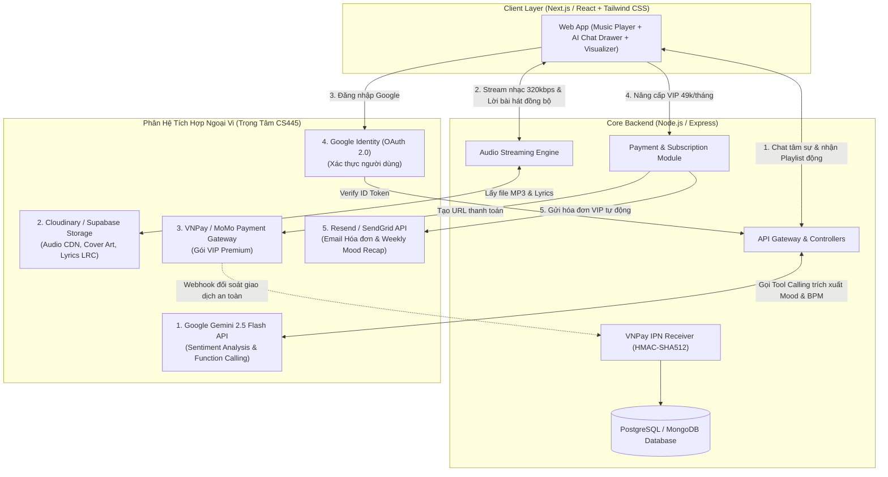

# 🎵 DMPTiFy - AI Mood-Based Music Streaming Platform
> **Môn học:** CS445 (CMU-CS 445 – Thực hành Tích hợp Hệ thống / System Integration Practices)  
> **Đơn vị:** Khoa Công nghệ Thông tin, Trường KHMT & TTNT, Đại học Duy Tân (DTU)  
> **GVHD:** Th.S Nguyễn Phúc Minh Tú  

[](https://opensource.org/licenses/MIT)
[](https://duytan.edu.vn)
[](https://ai.google.dev/)
[](https://sandbox.vnpayment.vn)

---

## 📌 1. Giới Thiệu Dự Án

**DMPTiFy** là nền tảng nghe nhạc trực tuyến đa nền tảng thế hệ mới, giải quyết triệt để vấn đề "bế tắc khi chọn nhạc" của người dùng. Tên gọi **DMPTiFy** được ghép từ tên các thành viên kiến tạo: **Đạt (D) - Minh (M) - Phú (P) - Thầy Tú (T)** lấy cảm hứng từ chuẩn mực nghe nhạc Spotify.

Thay vì dựa vào các thuật toán gợi ý thụ động theo lượt nghe phổ biến (Top Charts), **DMPTiFy** tích hợp **Trí tuệ Nhân tạo thế hệ mới (Google Gemini API)** có khả năng lắng nghe tâm sự tự nhiên của người nghe, thấu cảm và phân tích trạng thái cảm xúc (buồn, vui, cô đơn, căng thẳng, cần tập trung) để tự động sinh ra danh sách phát (Playlist) phù hợp nhất theo thời gian thực với nhịp điệu (BPM) và thể loại tương ứng.

---

## 👥 2. Đội Ngũ Phát Triển (Scrum Team)

| STT | Họ và Tên | MSSV | Vai trò | Trách nhiệm chính |
| :---: | :--- | :---: | :--- | :--- |
| **-** | **Th.S Nguyễn Phúc Minh Tú** | - | **GVHD / Product Owner** | Định hướng chuyên môn, giám sát tiến độ từng buổi học và nghiệm thu đồ án. |
| **1** | **Nguyễn Tuấn Đạt** | **28211305782** | **Scrum Master / Fullstack Lead** | Quản lý tiến độ Git, kiến trúc hệ thống, tích hợp VNPay Sandbox & Google OAuth. |
| **2** | **Trần Hoàng Phú** | *(Cập nhật)* | **Frontend & Audio UI Dev** | Phát triển Web Player Dark Mode, Audio Waveform Visualizer, Karaoke LRC Sync. |
| **3** | **Bùi Văn Minh** | *(Cập nhật)* | **Backend, AI Service & QA Tester** | Xây dựng RESTful API, tích hợp Gemini AI Function Calling, thiết kế DB và chạy TDD. |

---

## 🏗️ 3. Kiến Trúc 5 Trụ Cột Tích Hợp Hệ Thống (CS445 Integration Pillars)



---

## 🛠️ 4. Công Nghệ Sử Dụng (Tech Stack)

- **Frontend:** React.js / Next.js, Tailwind CSS, Web Audio API, Lucide Icons, Framer Motion.
- **Backend:** Node.js, Express.js (RESTful API, Clean Architecture).
- **Cơ sở dữ liệu:** PostgreSQL / MongoDB (Docker Compose).
- **Tích hợp AI:** Google Gemini 2.5 Flash API (Function Calling & Prompt Engineering).
- **Tích hợp Ngoại vi:**
  - Cổng thanh toán: **VNPay Sandbox** (Bảo mật chữ ký HMAC-SHA512 & IPN Webhook).
  - Lưu trữ Media & CDN: **Cloudinary**.
  - Xác thực người dùng: **Google OAuth 2.0** / JWT.
  - Gửi thông báo: **Resend Email API**.
- **Quản lý phiên bản & CI/CD:** Git, GitHub, Docker.

---

## 📅 5. Tiến Độ Thực Hiện 08 Buổi (Khớp 100% Lịch Trình Thời Gian Thực)

| Buổi | Thời gian thực | Đầu mục Tài liệu Báo cáo | Nhiệm vụ Kỹ thuật & Commit trên Git | Trạng thái |
| :---: | :---: | :--- | :--- | :---: |
| **Buổi 1** | **Thứ Bảy, 24/10/2026** *(Hôm nay)* | **`01_Proposal Document`** | Khởi tạo Git Repo sạch, chốt đề tài DMPTiFy, hoàn thành tài liệu đề xuất |  Hoàn thành |
| **Buổi 2** | **Thứ Bảy, 31/10/2026** | **`02_User Story`**, **`03_Product Backlog`**, **`04_Project Plan`** | Thiết lập User Stories, ước lượng Story Points, kế hoạch phân chia 4 Sprint | ⏳ Đang chuẩn bị |
| **Buổi 3** | **Thứ Bảy, 07/11/2026** | **`05_Database Design`** | Thiết kế ERD chuẩn 3NF, Data Dictionary, khởi tạo Schema PostgreSQL DB | ⏳ Chờ |
| **Buổi 4** | **Thứ Bảy, 14/11/2026** | **`06_User Interface Design`** | Dựng Wireframe & hoàn thiện UI Music Player Dark Mode chuẩn 60fps | ⏳ Chờ |
| **Buổi 5** | **Thứ Bảy, 21/11/2026** | **`07_Project Test Plan`** | Thiết lập tài liệu chiến lược kiểm thử (Unit, Integration, Security Webhook) | ⏳ Chờ |
| **Buổi 6** | **Thứ Bảy, 28/11/2026** | **`08_Test Case Sprint 1`**, **`09_Project Test Report`** | Kiểm thử chức năng Core Audio Player & xác thực Google OAuth | ⏳ Chờ |
| **Buổi 7** | **Thứ Bảy, 05/12/2026** | **`10_Sprint Backlog`**, **`11_Meeting Report`**, **`Configuration Mgmt`** | Báo cáo họp nhóm, tài liệu phân nhánh Git (Gitflow), CI/CD | ⏳ Chờ |
| **Buổi 8** | **Thứ Bảy, 12/12/2026** | **`12_Reflection Document`**, **`Tóm tắt báo cáo`**, Hoàn thiện | Đóng gói nghiệm thu, demo Webhook VNPay + AI Gemini và bảo vệ đồ án | ⏳ Chờ |

---

## 📂 6. Cấu Trúc Thư Mục Dự Án (Repository Structure)

```text
DMPTiFy_MusicAI/
├── client/                               # Frontend Web App (Next.js / React + Tailwind CSS)
├── server/                               # Backend Core API (Node.js / Express)
├── docker-compose.yml                    # Docker khởi chạy Database cục bộ
├── .gitignore                            # Cấu hình bỏ qua tệp tạm
└── README.md                             # Tài liệu tổng quan dự án
```

> **Lưu ý:** Toàn bộ hồ sơ báo cáo Word/Excel được quản lý độc lập tại thư mục tài liệu môn học của nhóm, không lưu trong kho mã nguồn Git để bảo đảm tiêu chuẩn phân tách mã nguồn và tài liệu.

---
*Khoa Công Nghệ Thông Tin – Đại học Duy Tân | Học kỳ I Năm học 2026 - 2027*
