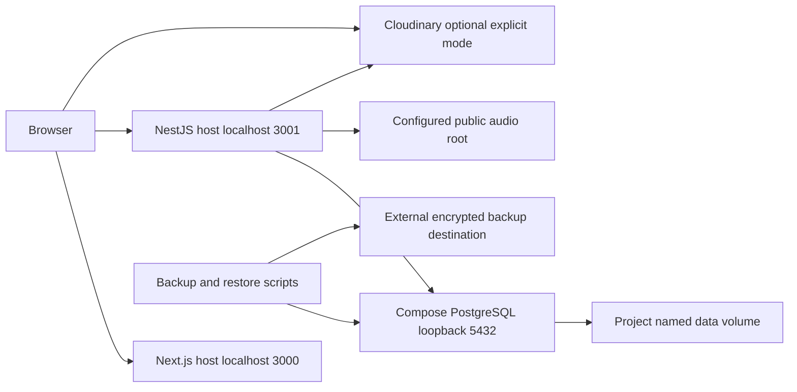

# Unit 1 Deployment Architecture

## Local Topology

Text alternative: the browser loads Next.js on port 3000 and calls NestJS on port 3001. NestJS queries Compose PostgreSQL on loopback port 5432 and either reads the configured local audio root or redirects to Cloudinary in explicitly selected provider mode. PostgreSQL persists to a project volume. Separate backup/restore scripts write to a configured encrypted destination outside that volume.

## Startup Order

1. Check approved runtime/tool versions, dependency lockfiles, free ports and selected mode configuration.
2. Start the project PostgreSQL service and wait for its health check.
3. Provision isolated roles/databases, apply migrations and run deterministic seeds explicitly.
4. Start NestJS with validated config and check liveness/readiness.
5. Start Next.js with backend base URL and open one new tab in the existing browser window.
6. Verify catalog, playlists, full/partial media, seeking, lyrics and safe error/retry behavior.

These steps are a design sequence, not executed commands. Code Generation will provide exact scripts and startup instructions.

## CI Topology

An ephemeral GitHub runner hosts root/server checks and a private PostgreSQL service with unique test credentials. Migrations/seeds run against the verified test database, followed by tests/PBT and contract/build checks. Local fixtures remove credential dependence. Sanitized reports/SBOM are uploaded with bounded retention. Provider smoke verification is a separate opt-in secret-backed path, never required for untrusted PR code.

## Failure and Recovery

- Database failure: readiness becomes non-ready; requests fail safely within budgets. Recover the dependency, recheck readiness and retry the user request.
- Missing local fixture: known-song playback returns safe 503; catalog remains available. Restore the approved source fixture; do not switch provider implicitly.
- Provider failure: bounded failure, safe logs, no local fallback.
- Migration failure: preserve data/backup and resolve through a reviewed forward-fix. Never reset the application database as a routine recovery step.
- Runtime rollback: redeploy the previous pinned artifact compatible with the current schema; if incompatible, use reviewed forward-fix/recovery guidance. A previous binary alone is not a database rollback.
- Graceful stop: terminate owned application processes, drain/close streams and pool; stop project services without deleting named volumes.

## Acceptance Evidence

Record fresh startup/migration/seed, full/206/416 HTTP results, browser seeking, readiness faults/recovery, resource/latency measurements and isolated restore. Record the actual deployed artifact/runtime versions. No local service, scheduler, CI run or provider account is claimed provisioned at this stage.
