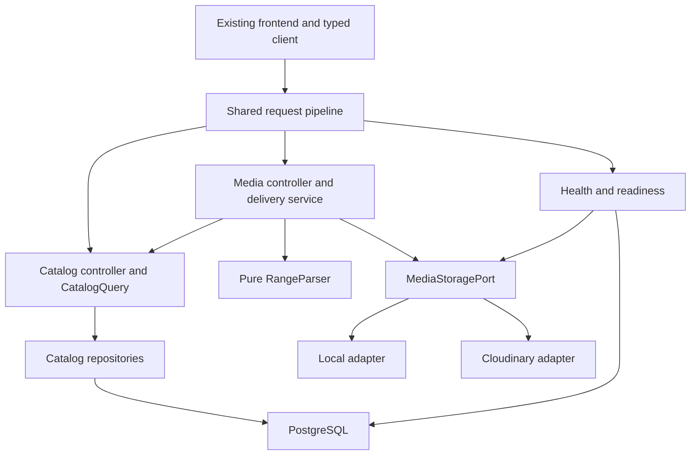

# Unit 1 Logical Components

## Responsibilities

| Component | Responsibility | Failure boundary |
|---|---|---|
| Application factory and Config | Validate selected mode, wire runtime/E2E consistently | Invalid required config stops startup |
| Request pipeline | Correlation ID, bounds, headers, CORS and route-specific throttles | Safe 4xx/429 before expensive work |
| Error/log boundary | Safe error mapping and structured redaction | Pre-header JSON vs post-header stream closure |
| CatalogQuery | Return valid ordered songs/playlists and derived counts | Bounded repository failure |
| Catalog repositories | Indexed reads, explicit migrations and idempotent seeds | Pool/query budgets; no automatic schema sync |
| Media delivery service | Resolve Song, apply deadline, select local/redirect outcome | Unknown Song 404; unavailable media 503 |
| RangeParser | Pure normalization/result for one Range and total size | Full, partial or 416; no filesystem effects |
| MediaStoragePort | Narrow metadata/local-stream/signed-delivery boundary | Explicit selected adapter; no fallback |
| Local adapter | Realpath containment, stat and bounded stream | Safe missing-file errors, cancellation cleanup |
| Cloudinary adapter | Configured signed delivery and bounded external probe | Provider timeout/config/capability error |
| Readiness service | Bounded dependency probes and 5s cache | Non-ready 503 with safe details |
| Typed frontend client/store | Contract types, hydration, retry and exact membership | Safe Vietnamese error state; no mock fallback |
| Test/evidence harness | Unit/E2E/PBT, performance/resource and recovery evidence | Reproducible failures; no runtime dependency |

## Dependency Direction

Text alternative: the browser enters the shared pipeline and reaches catalog, media, or health controllers. Catalog reads repositories backed by PostgreSQL. Media resolves catalog identity, uses a pure RangeParser, and delegates storage to the selected local or Cloudinary adapter. Readiness probes persistence and configured media independently. Configuration and logging support all components without reversing domain dependencies.

## Ownership and Lifecycle

- Unit 1 owns shared bootstrap, database, safe errors/config, catalog/media, OpenAPI/client generation and the initial test/CI foundation.
- Local handles belong to one response lifecycle. Abort, completion, stream error and shutdown all converge on idempotent cleanup.
- Database connections belong to the bounded pool and are returned after query/transaction completion or failure.
- Retry state belongs to one pre-stream request deadline; it is not a persistent queue.
- Readiness cache is instance-local and bounded; it does not cache audio/catalog or replace dependency availability checks.
- No broker, Redis, background invoice worker or authentication module is introduced in this unit.

## Deferred Infrastructure and Implementation Verification

Infrastructure Design maps these components to local processes, containers, ports, volumes, environment files and backup storage. Verify SDK and Node cancellation behavior, Cloudinary enforceable URL expiration, and stream/header compatibility against installed versions during implementation. Exact package/image pins are not inferred here. Unsupported provider expiry must be resolved before claiming the signed short-lived delivery contract accepted.
