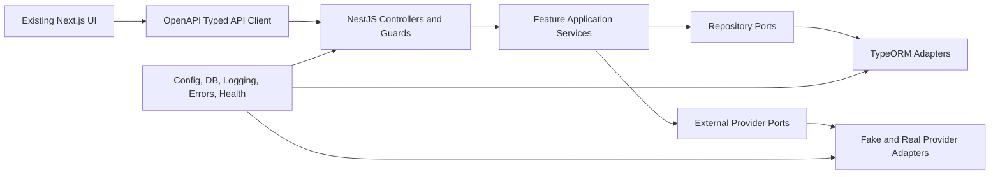
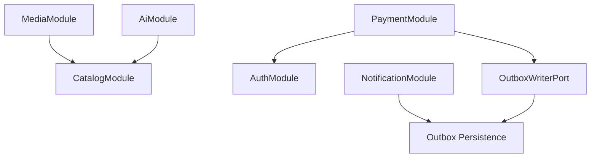

# Component Dependencies

## Dependency Direction

Text alternative: the existing UI calls one typed client, which calls Nest controllers. Controllers delegate to feature services. Services depend on repository/provider abstractions, and infrastructure adapters implement those abstractions. Shared platform components configure transport and infrastructure without owning feature behavior.

## Feature Dependency Graph

Text alternative: Media and AI read Catalog through narrow query contracts. Payment consumes authenticated identity from Auth and writes an outbox event. Notification consumes persisted outbox data asynchronously and has no synchronous dependency back to Payment.

## Dependency Matrix

| Consumer | Dependency | Pattern | Allowed data direction |
|---|---|---|---|
| Frontend | Typed API client | HTTP/OpenAPI | Safe API projections only |
| MediaModule | CatalogQuery | In-process read contract | Song media metadata |
| AiModule | CatalogQuery | In-process read contract | Recommendation candidates |
| AuthModule | GoogleTokenVerifierPort | Provider port | Verified identity result |
| PaymentModule | Auth principal | Guard/request context | User ID and entitlement context |
| PaymentModule | VnPayPort | Provider port | Signed URL and verified IPN facts |
| PaymentModule | OutboxWriterPort | Same DB transaction | Immutable payment-confirmed event |
| NotificationModule | Outbox repository | Poll/claim persistence | Committed events only |
| NotificationModule | InvoiceEmailPort | Provider port | Invoice input/result |
| All features | Shared platform | Configuration/infrastructure | Typed config and cross-cutting services |

## Forbidden Dependencies

- Frontend to external providers using server secrets.
- Controller to TypeORM repository without an application service.
- Feature service to concrete provider SDK.
- Catalog to AI/Auth/Payment/Notification.
- Auth to Payment or Notification.
- Notification synchronous call back into Payment.
- Provider adapter mutating User, PaymentTransaction, or VIP state.
- Shared platform importing feature business services.

## Data Ownership

| Data | Owner | Readers |
|---|---|---|
| Song, Playlist, PlaylistSong | CatalogModule | MediaModule, AiModule, frontend projections |
| User, AuthSession | AuthModule | PaymentModule through principal/user contract; frontend safe view |
| PaymentTransaction, VIP mutation transaction | PaymentModule | Auth current-user projection, audit/read models |
| OutboxEvent, EmailDelivery | NotificationModule persistence boundary; Payment writes only through OutboxWriterPort | Notification worker/operator diagnostics |

## Package Coordination

- Server DTO/OpenAPI changes land before the matching frontend client wiring in each slice.
- Generated/derived contract artifacts are validated for drift in CI.
- Migrations precede code paths requiring their schema.
- Each slice must leave both packages buildable before the next slice starts.
