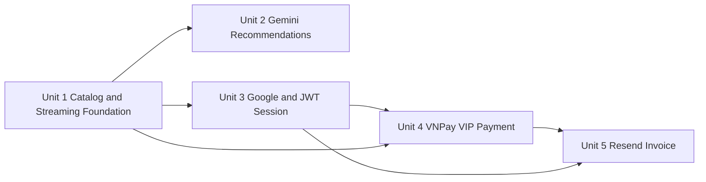

# Unit of Work Dependencies

## Dependency Graph

Text alternative: Unit 1 provides platform, database, catalog, contracts, and test foundation. Unit 2 needs Unit 1 catalog. Unit 3 needs Unit 1 platform/database. Unit 4 needs Unit 3 identity and Unit 1 platform. Unit 5 needs Unit 4 payment event and Unit 3 verified user email.

## Dependency Matrix

| Consumer unit | Required unit | Dependency | Strength |
|---|---|---|---|
| Unit 2 | Unit 1 | CatalogQuery, Song projection, config/error/provider patterns | Hard |
| Unit 3 | Unit 1 | Database/migration platform, application factory, OpenAPI/client baseline | Hard |
| Unit 4 | Unit 3 | Auth principal, User/VIP ownership, protected route | Hard |
| Unit 4 | Unit 1 | Database transactions, logging/errors, OpenAPI/client baseline | Hard |
| Unit 5 | Unit 4 | Committed payment event, OutboxEvent, transaction reference | Hard |
| Unit 5 | Unit 3 | Verified email/user identity encoded in approved event facts | Hard |

## Approved Delivery Order

1. Unit 1 reaches full Definition of Done.
2. Unit 2 reaches full Definition of Done.
3. Unit 3 reaches full Definition of Done.
4. Unit 4 reaches full Definition of Done.
5. Unit 5 reaches full Definition of Done.
6. Combined Build and Test validates the full system.

Although Units 2 and 3 are logically parallel after Unit 1, the approved delivery order remains sequential to prevent shared NestJS/OpenAPI/migration conflicts and to preserve one-unit-at-a-time TDD/review gates.

## Contract Handoffs

### Unit 1 to Later Units

- Production-equivalent application factory.
- Typed config, database transaction, logging/error, health, OpenAPI, and frontend client baseline.
- CatalogQuery and safe Song projections.
- CI/test skeleton including Vitest/Supertest/fast-check support.

### Unit 3 to Unit 4

- AuthPrincipal containing user ID/session context.
- User/VIP persistence ownership and safe current-user projection.
- JWT guard and credentialed-cookie frontend client behavior.

### Unit 4 to Unit 5

- Immutable `VipPaymentConfirmed` event schema.
- Transactional OutboxWriterPort implementation and unique payment/event identity.
- Persisted provider/payment facts approved for invoice use.

## Data/Migration Order

1. Unit 1 migrations: Song, Playlist, PlaylistSong and shared migration baseline.
2. Unit 3 migrations: User, AuthSession.
3. Unit 4 migrations: PaymentTransaction, OutboxEvent, VIP-related constraints.
4. Unit 5 migrations: EmailDelivery plus outbox claim/retry fields/indexes if not introduced in Unit 4.

Every migration is forward-only for normal delivery, preceded by backup guidance, and verified from a fresh database. A later unit may extend but must not silently rewrite an earlier unit's ownership boundary.

## Shared File Coordination

- One implementation owner modifies shared runtime/bootstrap/OpenAPI/config files at a time.
- Analysis/test/review subagents remain read-only unless assigned a disjoint file set.
- Generated OpenAPI/client changes occur inside the owning unit and are validated before frontend wiring.
- Package dependency changes are scoped to the unit plan and lockfiles are reviewed.

## Per-Unit Verification Handoff

Before a dependent unit starts, the required unit must provide:

- Passing unit/E2E/applicable PBT gates.
- Approved API/port contract.
- Applied and tested migrations/seeds.
- Resolved Standards and Spec review findings.
- No blocking Security, Resiliency, or PBT finding.

## Rollback and Failure Isolation

- A failing unit does not advance or trigger dependent-unit work.
- Runtime rollback uses the previous pinned artifact; database changes use backup plus forward-fix guidance.
- Provider failures remain behind ports and must not corrupt earlier-unit persisted state.
- Unit 5 failures cannot roll back Unit 4 payment/VIP state.
