# DMPTiFy AI-DLC Execution Plan

## Detailed Analysis Summary

### Transformation Scope

- **Transformation type**: architectural completion of a brownfield prototype.
- **Primary changes**: replace static/mock boundaries with five integrated NestJS vertical slices while preserving the existing frontend design.
- **Related components**: root Next.js app, NestJS server, PostgreSQL/TypeORM, local/Cloudinary media, Gemini, Google Identity, VNPay, Resend, Docker Compose, and GitHub Actions.
- **Infrastructure posture**: local/demo-first and deploy-ready; no mandatory public cloud, multi-region, or Kubernetes implementation.

### Change Impact Assessment

- **User-facing changes**: yes; real catalog, AI results, Google session, VIP upgrade, and invoice behavior are wired into existing UI.
- **Structural changes**: yes; domain NestJS modules, provider ports/adapters, persistence, shared bootstrap, typed frontend API client, and global cross-cutting concerns are added.
- **Data model changes**: yes; Song, Playlist, PlaylistSong, User, PaymentTransaction, and EmailDelivery.
- **API changes**: yes; catalog, streaming, AI, auth, payment, health/readiness, and session endpoints.
- **NFR impact**: high; security, idempotency, range performance, provider timeouts, logging, backup/restore, and CI gates.

### Component Relationships

- **Primary package**: `server/` NestJS application - major change.
- **Dependent package**: root Next.js application - minor, backward-compatible UI wiring.
- **Shared contract boundary**: typed DTO/API projections - critical coordination point.
- **Persistence**: PostgreSQL and TypeORM migrations - critical foundation.
- **Supporting components**: Docker Compose, GitHub Actions, structured logging, health/readiness, and provider configuration.
- **External dependencies**: Cloudinary, Gemini, Google Identity, VNPay Sandbox, and Resend, each behind an explicit adapter.

### Risk Assessment

- **Risk level**: High.
- **Reason**: authentication, signed payment callbacks, entitlement mutation, external provider failures, and binary range semantics.
- **Why not Critical**: the accepted target is local/sandbox academic demonstration rather than production financial settlement.
- **Rollback complexity**: Moderate; version-pinned application rollback plus TypeORM forward-fix and backup-before-migration.
- **Testing complexity**: Complex; unit, E2E, integration, failure, idempotency, and partial property-based tests.

## Workflow Visualization

```mermaid
flowchart TD
    Start(["Approved CS445 Scope"])
    WD["Workspace Detection - COMPLETED"]
    RE["Reverse Engineering - COMPLETED"]
    RA["Requirements - COMPLETED"]
    US["User Stories - COMPLETED"]
    WP["Workflow Planning - IN REVIEW"]
    AD["Application Design - EXECUTE"]
    UG["Units Generation - EXECUTE"]
    S1["Slice 1 Per-Unit Loop"]
    S2["Slice 2 Per-Unit Loop"]
    S3["Slice 3 Per-Unit Loop"]
    S4["Slice 4 Per-Unit Loop"]
    S5["Slice 5 Per-Unit Loop"]
    BT["Build and Test - EXECUTE"]
    OPS["Operations - PLACEHOLDER"]
    End(["CS445 Integrated Demo"])
    Start --> WD --> RE --> RA --> US --> WP --> AD --> UG
    UG --> S1 --> S2 --> S3 --> S4 --> S5 --> BT --> OPS --> End
    style WD fill:#4CAF50,stroke:#1B5E20,stroke-width:3px,color:#fff
    style RE fill:#4CAF50,stroke:#1B5E20,stroke-width:3px,color:#fff
    style RA fill:#4CAF50,stroke:#1B5E20,stroke-width:3px,color:#fff
    style US fill:#4CAF50,stroke:#1B5E20,stroke-width:3px,color:#fff
    style WP fill:#FFA726,stroke:#E65100,stroke-width:3px,stroke-dasharray:5 5,color:#000
    style AD fill:#FFA726,stroke:#E65100,stroke-width:3px,stroke-dasharray:5 5,color:#000
    style UG fill:#FFA726,stroke:#E65100,stroke-width:3px,stroke-dasharray:5 5,color:#000
    style S1 fill:#FFA726,stroke:#E65100,stroke-width:3px,stroke-dasharray:5 5,color:#000
    style S2 fill:#FFA726,stroke:#E65100,stroke-width:3px,stroke-dasharray:5 5,color:#000
    style S3 fill:#FFA726,stroke:#E65100,stroke-width:3px,stroke-dasharray:5 5,color:#000
    style S4 fill:#FFA726,stroke:#E65100,stroke-width:3px,stroke-dasharray:5 5,color:#000
    style S5 fill:#FFA726,stroke:#E65100,stroke-width:3px,stroke-dasharray:5 5,color:#000
    style BT fill:#4CAF50,stroke:#1B5E20,stroke-width:3px,color:#fff
    style OPS fill:#BDBDBD,stroke:#424242,stroke-width:2px,stroke-dasharray:5 5,color:#000
    style Start fill:#CE93D8,stroke:#6A1B9A,stroke-width:3px,color:#000
    style End fill:#CE93D8,stroke:#6A1B9A,stroke-width:3px,color:#000
    linkStyle default stroke:#333,stroke-width:2px
```

Text alternative: all completed Inception artifacts lead to Workflow Planning, then Application Design and Units Generation. Construction executes Slice 1 through Slice 5 sequentially, followed by the combined Build and Test gate. Operations remains a placeholder.

## Phases to Execute

### Inception

- [x] Workspace Detection - COMPLETED.
- [x] Reverse Engineering - COMPLETED.
- [x] Requirements Analysis - COMPLETED.
- [x] User Stories - COMPLETED.
- [x] Workflow Planning - generated and awaiting approval.
- [ ] Application Design - EXECUTE at comprehensive depth.
  - **Rationale**: new domain modules, provider interfaces, methods, data ownership, security boundaries, and frontend/backend contracts require explicit design.
- [ ] Units Generation - EXECUTE at comprehensive depth.
  - **Rationale**: the user mandated exactly five dependent vertical units with schemas, endpoints, tests, and package coordination.

### Construction

- [ ] Functional Design - EXECUTE for every slice.
  - **Rationale**: each slice contains business rules, validation, state transitions, or binary/protocol logic.
- [ ] NFR Requirements - EXECUTE for every slice.
  - **Rationale**: each external boundary has security, reliability, testability, privacy, or performance requirements.
- [ ] NFR Design - EXECUTE for every slice.
  - **Rationale**: enabled Security and Resiliency rules must be mapped into concrete patterns. RESILIENCY-14 testing approach will be decided here.
- [ ] Infrastructure Design - EXECUTE for Slice 1 shared foundation; SKIP by default for Slices 2-5.
  - **Rationale**: Slice 1 owns Docker Compose PostgreSQL, migrations, local media, environment baseline, and initial CI skeleton. Later slices add provider configuration through application/NFR design unless deployment mapping materially changes.
- [ ] Code Generation - EXECUTE for every slice.
  - **Rationale**: each approved unit needs a user-approved generation plan, TDD implementation, docs, and verification.
- [ ] Build and Test - EXECUTE after all five units.
  - **Rationale**: combined build, migration, provider-mode, integration, security, PBT, and demo verification are mandatory.

### Operations

- [ ] Operations - PLACEHOLDER/SKIP implementation.
  - **Rationale**: the installed AI-DLC workflow defines Operations as a placeholder. Deployment/runbook requirements will be captured in Construction build-and-test artifacts.

## Per-Slice Stage Matrix

| Unit | Functional Design | NFR Requirements | NFR Design | Infrastructure Design | Code Generation |
|---|---|---|---|---|---|
| Slice 1 Catalog/Streaming | Execute | Execute | Execute | Execute shared foundation | Execute |
| Slice 2 Gemini | Execute | Execute | Execute | Skip unless deployment changes | Execute |
| Slice 3 Google/JWT | Execute | Execute | Execute | Skip unless deployment changes | Execute |
| Slice 4 VNPay | Execute | Execute | Execute | Skip unless deployment changes | Execute |
| Slice 5 Resend | Execute | Execute | Execute | Skip unless deployment changes | Execute |

## Unit and Package Update Sequence

1. **Slice 1 - Catalog/Streaming foundation**
   - Add shared Nest bootstrap, configuration, validation, logging, database, migrations, seeds, media adapter, contracts, tests, Docker Compose, and initial CI.
   - Wire the root Next.js catalog/player through the typed API client.
2. **Slice 2 - Gemini mood analysis**
   - Depend on Slice 1 persisted catalog and shared provider/config/error patterns.
   - Replace only the simulated AI data path in the existing drawer.
3. **Slice 3 - Google OAuth/JWT**
   - Add User persistence and protected-session boundary.
   - Wire minimal sign-in/profile behavior without redesign.
4. **Slice 4 - VNPay VIP payment**
   - Depend on Slice 3 authenticated User and Slice 1 transaction/config foundation.
   - Add payment persistence, HMAC, IPN idempotency, VIP activation, and CTA wiring.
5. **Slice 5 - Resend invoice**
   - Depend on Slice 4 committed payment/VIP state and Slice 3 verified email.
   - Add independent idempotent delivery/retry behavior.
6. **Combined Build and Test**
   - Run root and server gates, fresh database migration/seed, all fake-provider E2E, partial PBT, sandbox smoke instructions, security review, and full listener journey.

## Superpowers Coordination Model

- Units remain sequential because they share Nest modules, migrations, and contracts.
- Within a unit, subagents may independently analyze API/spec, tests/security, or review findings.
- Only one implementation owner edits shared runtime files at a time.
- `/review` uses two parallel subagents for Standards and Spec after each slice.
- `/diagnose` is activated only when a deterministic quality gate fails or a bug is reproduced; it is not used as ceremonial overhead.

## Quality Gate Per Vertical Slice

1. Confirm public interface and priority behaviors with the user-approved unit plan.
2. `/tdd`: one integration-style failing test for one observable behavior.
3. Minimal implementation to GREEN, then repeat behavior by behavior.
4. Refactor only while all relevant tests are GREEN.
5. Run slice lint, type/build, unit, E2E, and applicable fast-check properties.
6. `/diagnose`: if a gate fails unexpectedly, reproduce, rank falsifiable hypotheses, fix, and add regression coverage.
7. `/review`: Standards and Spec reviews in parallel against an explicitly pinned fixed point and the approved slice artifacts.
8. Resolve blocking Security, Resiliency, PBT, Standards, and Spec findings before advancing.

## Review Baseline Gate

The current working tree already contains uncommitted application work and AI-DLC artifacts. Before the first Construction code-generation step, a review baseline must be explicitly chosen and recorded. No commit, stash, reset, or checkout will be performed without user authorization. Until then, review will report working-tree diffs separately from committed-history comparisons.

## Engineering-Skill Setup Gate

Before `/tdd`, `/diagnose`, and `/review` are first used in Construction, finish the repository engineering-skill configuration:

- GitHub Issues as the selected issue/change tracker.
- Triage label vocabulary confirmation.
- Single-context versus multi-context domain-document layout confirmation.
- Add `docs/agents/*` and the `AGENTS.md` Agent Skills block only after explicit approval of their draft.

## Relative Effort

- **Inception remaining**: Application Design and Units Generation.
- **Construction**: five per-unit loops plus one combined Build and Test gate.
- **Expected implementation shape**: approximately 20-30 focused tracer-bullet behaviors, not a calendar commitment.
- **Schedule dependencies**: provider credentials, VNPay callback reachability, and Google OAuth client configuration.

## Success Criteria

- Exactly five integrated units satisfy the approved requirements and stories.
- Existing frontend design remains intact.
- Fake mode runs fully locally and provider mode fails fast without secrets.
- Security, Resiliency, and partial PBT gates have no blocking findings.
- Root/server lint, build, unit, E2E, migration, seed, and combined journey checks pass.
- Documentation clearly separates local fake mode, sandbox mode, and future production posture.

## Extension Compliance at Workflow Planning

### Security

- Applicable rules are scheduled into Application Design, per-unit NFR Design, code quality gates, and combined verification.
- Security-critical modules remain separated and fail-closed.
- Cloud IAM/network rules remain N/A unless public cloud infrastructure is later added.
- No blocking planning finding.

### Resiliency

- Approved RTO/RPO, backup/restore, GitHub change/incident flow, rollback, health, timeout/retry, idempotency, and local topology are scheduled.
- RESILIENCY-14 testing approach remains an explicit NFR Design decision, as allowed by the rule.
- Production multi-zone/autoscaling/multi-region implementation remains outside mandatory local-demo acceptance.
- No blocking planning finding.

### Property-Based Testing

- Partial PBT is scheduled for Range and VNPay pure logic using fast-check with reusable generators, shrinking, and seed replay.
- Example-based business tests remain mandatory.
- No blocking planning finding.
