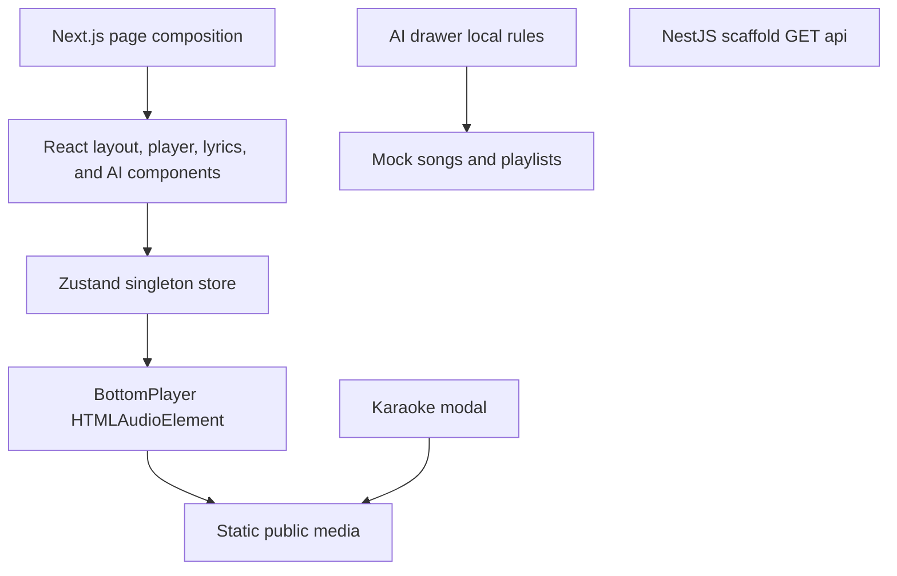
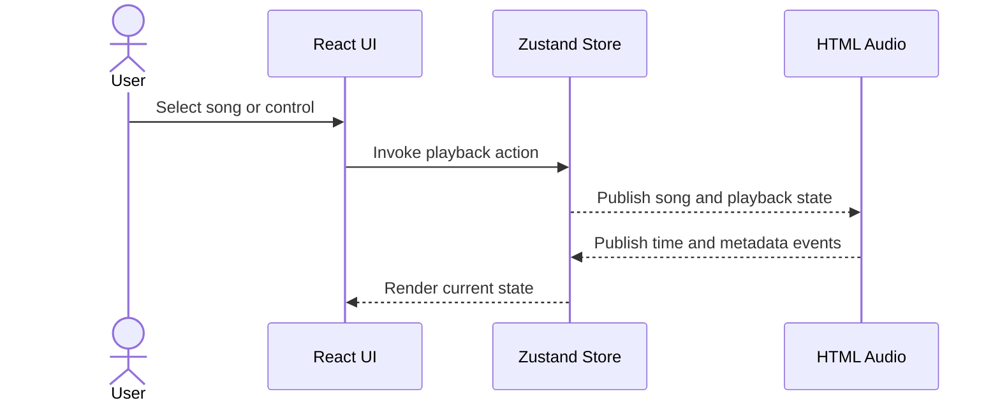
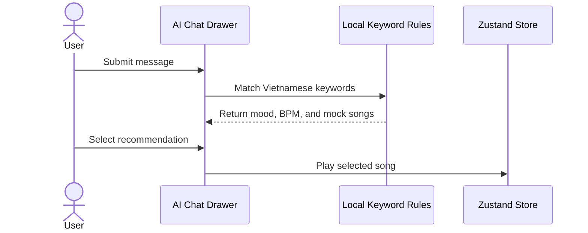

# System Architecture

## System Overview

The repository contains two independently managed npm packages. The root Next.js application is a static client-side prototype. The `server/` NestJS package is a scaffold and has no domain integration with the frontend. No database, queue, cache, cloud infrastructure, or external service SDK is present.

## As-Is Architecture Diagram

Text alternative: React components share a Zustand store. The bottom player owns browser audio and reads static assets. Karaoke fetches static lyrics, while AI chat uses local rules and mock data. The NestJS server is disconnected.

## Component Descriptions

### Frontend Package

- **Type**: Application.
- **Purpose**: browser UI and prototype playback.
- **Dependencies**: Next.js, React, Zustand, Tailwind CSS, Lucide.
- **Runtime data**: local mock arrays and static files only.

### Backend Package

- **Type**: Application scaffold.
- **Purpose**: future REST API and integrations.
- **Dependencies**: NestJS Express adapter, RxJS, reflect-metadata.
- **Runtime API**: `GET /api` returns plain text.

### Test Components

- **Type**: Test.
- **Purpose**: validate the Nest starter controller.
- **Scope**: one unit and one E2E assertion for `Hello World!`.

## Playback Interaction

Text alternative: a user action updates Zustand, BottomPlayer synchronizes the state to the browser audio element, and media events update Zustand for the UI.

## Simulated Recommendation Interaction

Text alternative: no AI or backend call occurs; the component matches keywords locally and returns static songs after a timeout.

## Data Flow and Boundaries

- `MOCK_SONGS` initializes the Zustand queue and supplies AI recommendations.
- `queue` currently serves as catalog, playback queue, and liked-state collection.
- `BottomPlayer` is the only owner of the `<audio>` element.
- `seekTarget` is command state used to request external seeks.
- Lyrics are fetched from `/lyrics/*.lrc` and parsed inside the modal.
- Frontend makes no call to the NestJS server.

## Integration Points

### Implemented

- Browser `HTMLAudioElement`.
- Static HTTP assets served by Next.js.

### Target Only

- Google Gemini, Google Identity, VNPay, Cloudinary or equivalent CDN, Resend or SendGrid, and PostgreSQL or MongoDB.

## Infrastructure Components

- **Implemented**: none beyond local Next.js and NestJS processes.
- **Deployment configuration**: none.
- **CI/CD**: none.
- **Container/IaC/networking**: none.
- **NestJS Mau**: dependency and script exist, but no deployment artifact is configured.
