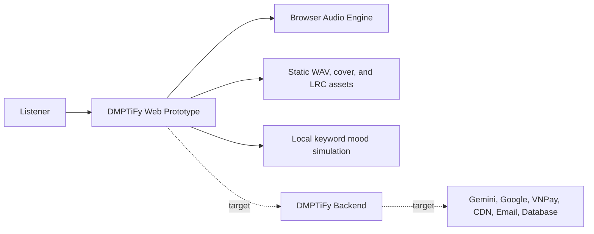

# Business Overview

## Analysis Scope

This document distinguishes the running implementation (**As-Is**) from the vision described in `README.md` (**Target**). Items marked as target capabilities are not yet implemented unless stated otherwise.

## Business Context Diagram

Text alternative: today the listener interacts with a browser-only prototype backed by static media and local state. The backend and external integrations shown with target relationships are planned but not implemented.

## Business Description

- **As-Is business**: a Vietnamese music-player demo that helps a listener discover and play songs by mood, view synchronized lyrics, manage in-memory likes, and receive simulated mood-based recommendations.
- **Target business**: an AI-assisted streaming platform with persistent identity, personal library, real Gemini recommendations, hosted media, VIP subscription payment, and transactional email.

## Implemented Business Transactions

1. Browse, search, and filter the five-song local catalog.
2. Play, pause, seek, skip, shuffle, repeat, mute, and adjust volume.
3. Like or unlike a song for the current browser session.
4. Load a static LRC file, follow the active lyric, and seek by selecting a lyric line.
5. Submit a chat message to local keyword rules and receive a delayed static recommendation.
6. Select a playlist card or liked-songs entry to apply a local filter.
7. Open the navigation and VIP call-to-action on desktop or mobile.

## Target-Only Business Transactions

- Google identity and JWT/session management.
- Persistent catalog, playlists, likes, playback history, and user preferences.
- Gemini sentiment analysis and structured recommendation generation.
- CDN-backed media streaming and asset management.
- VIP purchase, VNPay redirect, signed IPN processing, subscription activation, and invoice email.
- Administrative catalog and operational workflows.

## Business Dictionary

| Term | Current meaning | Design concern |
|---|---|---|
| Song | Track metadata plus audio, cover, lyrics, mood, BPM, and optional liked state | Persistence identity and availability rules are undefined |
| Playlist | Display metadata, count, mood, and AI flag | It has no membership or ownership model |
| Catalog | Implicitly the same array as the playback queue | Must be separated from queue and user library |
| Queue | Ordered songs used for rendering and playback | Currently also stores liked state |
| Mood | One of chill, sad, energetic, focus, or acoustic | Filter values `all` and `liked` are not moods |
| Karaoke | Parsed LRC lines synchronized with player time | Error and cancellation behavior is incomplete |
| AI Recommendation | Local keyword result with mood, BPM, and static songs | No Gemini request, schema, safety, or rate limit exists |
| VIP | Upgrade call-to-action | No subscription, entitlement, or payment state exists |

## Component-Level Business Descriptions

### Next.js Web Application

- **Purpose**: provide the listener-facing discovery and playback experience.
- **Responsibilities**: navigation, filtering, playback controls, lyrics, simulated AI chat, and VIP presentation.

### Zustand Audio Store

- **Purpose**: coordinate playback commands and shared UI state.
- **Responsibilities**: queue, current song, timing, volume, repeat/shuffle, likes, filters, and overlay state.

### NestJS Server

- **Purpose**: intended backend boundary for domain and integrations.
- **Current responsibility**: only a scaffold health-like response returning `Hello World!`.

### Static Media

- **Purpose**: make the prototype self-contained.
- **Responsibilities**: five WAV samples, five covers, and five LRC files.
