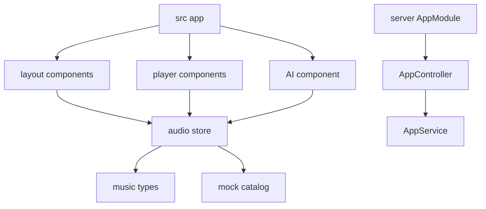

# Code Structure

## Build System

- Root frontend: npm with a root `package.json` and `package-lock.json`.
- Backend: separate npm package and lockfile under `server/`.
- There is no npm workspace or root orchestration command for both packages.
- Frontend quality: ESLint and Next production build.
- Backend quality: Oxlint, Nest build, Vitest unit/E2E, and optional coverage.

## Module Hierarchy

Text alternative: the Next route composes layout, player, and AI components around a shared store and mock domain types. The backend is a single controller-service module.

## Existing Source Inventory

### Frontend

- `src/app/layout.tsx` - metadata, Vietnamese locale, and root document.
- `src/app/page.tsx` - application composition and mobile-sidebar coordination.
- `src/app/globals.css` - Tailwind import, glass effects, scrollbars, and animations.
- `src/components/layout/Sidebar.tsx` - navigation, playlist filters, VIP CTA, mobile drawer.
- `src/components/layout/TopNav.tsx` - search, mood filters, profile, AI and mobile-menu triggers.
- `src/components/layout/MainContent.tsx` - hero, catalog, empty state, and playlist cards.
- `src/components/player/BottomPlayer.tsx` - audio element and transport controls.
- `src/components/player/KaraokeLyricsModal.tsx` - LRC loading, parsing, synchronization, and seeking.
- `src/components/ai/AiChatDrawer.tsx` - simulated chat and recommendation rules.
- `src/store/useAudioStore.ts` - shared playback and UI state/actions.
- `src/types/music.ts` - song, playlist, lyric, and mood types.
- `src/lib/mock-songs.ts` - five songs and four playlists.

### Backend

- `server/src/main.ts` - Nest bootstrap, unrestricted CORS, `/api` prefix, port selection.
- `server/src/app.module.ts` - empty root business module.
- `server/src/app.controller.ts` - root GET controller.
- `server/src/app.service.ts` - `Hello World!` service.
- `server/src/app.controller.spec.ts` - starter unit test.
- `server/test/app.e2e-spec.ts` - starter E2E test.

### Configuration and Assets

- Root: `package.json`, `next.config.ts`, `tsconfig.json`, `eslint.config.mjs`, `AGENTS.md`.
- Server: `package.json`, `nest-cli.json`, `tsconfig*.json`, `oxlint.json`, `vitest.config*.ts`, `.prettierrc`.
- Public assets: five WAV files, five SVG covers, five LRC files, favicon, and starter SVGs.

## Design Patterns

### Central Client Store

- **Location**: `src/store/useAudioStore.ts`.
- **Purpose**: synchronize playback and overlays across sibling components.
- **Implementation**: Zustand actions and granular selectors in most components.

### Command State for Seeking

- **Location**: `seekTarget` in the store and `BottomPlayer` effect.
- **Purpose**: transmit seek requests from lyrics and store actions to the audio element.

### Controller-Service Dependency Injection

- **Location**: NestJS scaffold.
- **Purpose**: framework-standard separation, currently without business logic.

## Notable Structural Debt

- AI business logic is embedded in a React component.
- Catalog, playback queue, and user library are conflated.
- Playlist membership and ownership are absent.
- Root and backend packages share no contracts or orchestration.
- `setCurrentSong`, `setLyrics`, stored `lyrics`, and `resume` appear unused or shallow.
- Generated `tsconfig.tsbuildinfo` is tracked or unignored in parts of the workspace.
