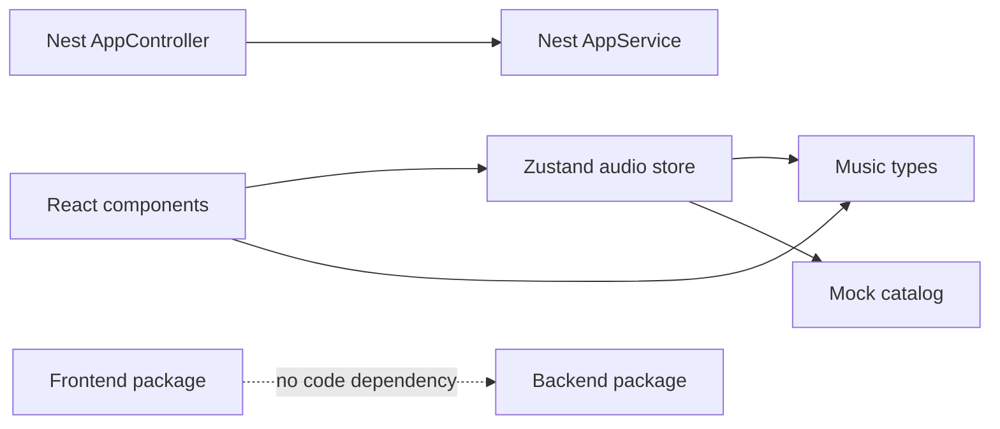

# Dependencies

## Internal Dependencies

Text alternative: frontend components depend on the audio store, music types, and mock catalog. The backend controller depends on its service. There is no code or runtime contract dependency between packages.

## Direct Frontend Dependencies

| Dependency | Resolved version | License | Purpose |
|---|---:|---|---|
| next | 16.4.3 | MIT | Web framework and build |
| react / react-dom | 19.3.0 | MIT | UI runtime |
| zustand | 5.0.16 | MIT | Shared client state |
| lucide-react | 1.61.0 | ISC | Icons |
| tailwindcss | 4.3.3 | MIT | Styling |
| typescript | 5.9.3 | Apache-2.0 | Type checking |
| eslint | 9.39.5 | MIT | Linting |

## Direct Backend Dependencies

| Dependency | Resolved version | License | Purpose |
|---|---:|---|---|
| @nestjs/common / core / platform-express | 12.2.0 | MIT | HTTP application framework |
| rxjs | 7.8.2 | Apache-2.0 | Nest reactive primitives |
| reflect-metadata | 0.2.2 | Apache-2.0 | Decorator metadata |
| vitest | 4.1.12 | MIT | Unit and E2E runner |
| supertest | 7.3.1 | MIT | HTTP assertions |
| oxlint | 1.89.0 | MIT | Backend linting |
| typescript | 6.0.3 | Apache-2.0 | Compilation |

## Dependency Risks

- No shared DTO/contract package exists.
- Root and server dependency lifecycles are independent.
- The two packages use different TypeScript major versions.
- The Vite path plugin is redundant according to the current test-runner warning.
- No complete transitive-license audit or SBOM has been performed.
- README says MIT, root package has no license field or LICENSE file, and backend declares `UNLICENSED`.
