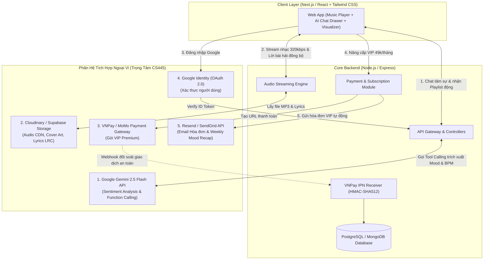

# 🎵 DMPTiFy - AI Mood-Based Music Streaming Platform
> Generated Codebase Context for AI Review (ChatGPT / Claude / Google AI Studio / DeepSeek)
> Date: 2026-11-08 20:56:52
> Author: Nguyen Tuan Dat & Team DMPTiFy

---

## 🤖 SYSTEM REVIEW PROMPT (Copy phần này gửi kèm model):
``text
Bạn là một Principal Fullstack Architect, Senior Security Engineer và QA Lead.
Dưới đây là toàn bộ mã nguồn của dự án DMPTiFy - nền tảng nghe nhạc trực tuyến tích hợp AI gợi ý theo cảm xúc (CS445 - Đại học Duy Tân).
Stack: Next.js 16 (App Router) + React 19 + Tailwind CSS v4 + Zustand 5 (Frontend) & NestJS 12 (Backend).

Hãy thực hiện một bài Review Codebase toàn diện và chuyên sâu theo các mục sau:
1. Đánh giá Kiến Trúc (Architecture & Design Patterns): Đánh giá tính module hóa, separation of concerns giữa Client UI, Audio Store và Backend NestJS.
2. Soi Lỗi Tiềm Ẩn (Bug Hunting & Edge Cases): Kiểm tra Audio Lifecycle (play/pause, seek, audio context leaks, unmount cleanup, song change race conditions), LRC parser edge cases.
3. Hiệu Năng & Tối Ưu (Performance): Render re-renders trong Zustand, Next.js 16 SSR vs CSR hydration, Tailwind v4 styling.
4. Bảo Mật & Kỹ Nghệ (Security & Code Quality): Type safety trong TypeScript, validation, sanitization.
5. Đề Xuất Kiến Trúc Cho 5 Trụ Cột Tích Hợp (CS445 Integration):
   - Trụ cột 1: Google Gemini 2.5 Flash Function Calling (Chuyển từ mock ở client sang NestJS controller).
   - Trụ cột 2: Cloudinary / Supabase Audio CDN & Audio Streaming Range Request (HTTP 206).
   - Trụ cột 3: VNPay Gateway Sandbox (Tạo payment URL, verify chữ ký HMAC-SHA512, IPN Webhook).
   - Trụ cột 4: Google OAuth 2.0 & JWT Session Guard trong NestJS.
   - Trụ cột 5: Resend Email Notification (Gửi biên lai VIP).
6. Actionable Checklist: Liệt kê top 5 việc cần làm ngay kèm code mẫu refactor minh họa.
``

---

## 🌳 CẤU TRÚC THƯ MỤC DỰ ÁN
``text
DMPTiFy_MusicAI/
├── src/
│   ├── app/
│   │   ├── globals.css
│   │   ├── layout.tsx
│   │   └── page.tsx
│   ├── components/
│   │   ├── ai/AiChatDrawer.tsx
│   │   ├── layout/MainContent.tsx, Sidebar.tsx, TopNav.tsx, ThemeSwitcher.tsx
│   │   └── player/BottomPlayer.tsx, KaraokeLyricsModal.tsx
│   ├── lib/mock-songs.ts
│   ├── store/useAudioStore.ts, useThemeStore.ts
│   └── types/music.ts
├── server/
│   ├── src/
│   │   ├── app.controller.spec.ts
│   │   ├── app.controller.ts
│   │   ├── app.module.ts
│   │   ├── app.service.ts
│   │   └── main.ts
│   ├── test/
│   │   └── app.e2e-spec.ts
│   ├── package.json
│   └── vitest.config.e2e.ts
├── package.json
└── README.md
``

---

## 📄 File: README.md
`$lang
# 🎵 DMPTiFy - AI Mood-Based Music Streaming Platform
> **Môn học:** CS445 (CMU-CS 445 – Thực hành Tích hợp Hệ thống / System Integration Practices)  
> **Đơn vị:** Khoa Công nghệ Thông tin, Trường KHMT & TTNT, Đại học Duy Tân (DTU)  
> **GVHD:** Th.S Nguyễn Phúc Minh Tú  

[](https://opensource.org/licenses/MIT)
[](https://duytan.edu.vn)
[](https://ai.google.dev/)
[](https://sandbox.vnpayment.vn)

---

## 📌 1. Giới Thiệu Dự Án

**DMPTiFy** là nền tảng nghe nhạc trực tuyến đa nền tảng thế hệ mới, giải quyết triệt để vấn đề "bế tắc khi chọn nhạc" của người dùng. Tên gọi **DMPTiFy** được ghép từ tên các thành viên kiến tạo: **Đạt (D) - Minh (M) - Phú (P) - Thầy Tú (T)** lấy cảm hứng từ chuẩn mực nghe nhạc Spotify.

Thay vì dựa vào các thuật toán gợi ý thụ động theo lượt nghe phổ biến (Top Charts), **DMPTiFy** tích hợp **Trí tuệ Nhân tạo thế hệ mới (Google Gemini API)** có khả năng lắng nghe tâm sự tự nhiên của người nghe, thấu cảm và phân tích trạng thái cảm xúc (buồn, vui, cô đơn, căng thẳng, cần tập trung) để tự động sinh ra danh sách phát (Playlist) phù hợp nhất theo thời gian thực với nhịp điệu (BPM) và thể loại tương ứng.

---

## 👥 2. Đội Ngũ Phát Triển (Scrum Team)

| STT | Họ và Tên | MSSV | Vai trò | Trách nhiệm chính |
| :---: | :--- | :---: | :--- | :--- |
| **-** | **Th.S Nguyễn Phúc Minh Tú** | - | **GVHD / Product Owner** | Định hướng chuyên môn, giám sát tiến độ từng buổi học và nghiệm thu đồ án. |
| **1** | **Nguyễn Tuấn Đạt** | **28211305782** | **Scrum Master / Fullstack Lead** | Quản lý tiến độ Git, kiến trúc hệ thống, tích hợp VNPay Sandbox & Google OAuth. |
| **2** | **Trần Hoàng Phú** | *(Cập nhật)* | **Frontend & Audio UI Dev** | Phát triển Web Player Dark Mode, Audio Waveform Visualizer, Karaoke LRC Sync. |
| **3** | **Bùi Văn Minh** | *(Cập nhật)* | **Backend, AI Service & QA Tester** | Xây dựng RESTful API, tích hợp Gemini AI Function Calling, thiết kế DB và chạy TDD. |

---

## 🏗️ 3. Kiến Trúc 5 Trụ Cột Tích Hợp Hệ Thống (CS445 Integration Pillars)



---

## 🛠️ 4. Công Nghệ Sử Dụng (Tech Stack)

- **Frontend:** React.js / Next.js, Tailwind CSS, Web Audio API, Lucide Icons, Framer Motion.
- **Backend:** Node.js, Express.js (RESTful API, Clean Architecture).
- **Cơ sở dữ liệu:** PostgreSQL / MongoDB (Docker Compose).
- **Tích hợp AI:** Google Gemini 2.5 Flash API (Function Calling & Prompt Engineering).
- **Tích hợp Ngoại vi:**
  - Cổng thanh toán: **VNPay Sandbox** (Bảo mật chữ ký HMAC-SHA512 & IPN Webhook).
  - Lưu trữ Media & CDN: **Cloudinary**.
  - Xác thực người dùng: **Google OAuth 2.0** / JWT.
  - Gửi thông báo: **Resend Email API**.
- **Quản lý phiên bản & CI/CD:** Git, GitHub, Docker.

---

## 📅 5. Tiến Độ Thực Hiện 08 Buổi (Khớp 100% Lịch Trình Thời Gian Thực)

| Buổi | Thời gian thực | Đầu mục Tài liệu Báo cáo | Nhiệm vụ Kỹ thuật & Commit trên Git | Trạng thái |
| :---: | :---: | :--- | :--- | :---: |
| **Buổi 1** | **Thứ Bảy, 24/10/2026** *(Hôm nay)* | **`01_Proposal Document`** | Khởi tạo Git Repo sạch, chốt đề tài DMPTiFy, hoàn thành tài liệu đề xuất |  Hoàn thành |
| **Buổi 2** | **Thứ Bảy, 31/10/2026** | **`02_User Story`**, **`03_Product Backlog`**, **`04_Project Plan`** | Thiết lập User Stories, ước lượng Story Points, kế hoạch phân chia 4 Sprint | ⏳ Đang chuẩn bị |
| **Buổi 3** | **Thứ Bảy, 07/11/2026** | **`05_Database Design`** | Thiết kế ERD chuẩn 3NF, Data Dictionary, khởi tạo Schema PostgreSQL DB | ⏳ Chờ |
| **Buổi 4** | **Thứ Bảy, 14/11/2026** | **`06_User Interface Design`** | Dựng Wireframe & hoàn thiện UI Music Player Dark Mode chuẩn 60fps | ⏳ Chờ |
| **Buổi 5** | **Thứ Bảy, 21/11/2026** | **`07_Project Test Plan`** | Thiết lập tài liệu chiến lược kiểm thử (Unit, Integration, Security Webhook) | ⏳ Chờ |
| **Buổi 6** | **Thứ Bảy, 28/11/2026** | **`08_Test Case Sprint 1`**, **`09_Project Test Report`** | Kiểm thử chức năng Core Audio Player & xác thực Google OAuth | ⏳ Chờ |
| **Buổi 7** | **Thứ Bảy, 05/12/2026** | **`10_Sprint Backlog`**, **`11_Meeting Report`**, **`Configuration Mgmt`** | Báo cáo họp nhóm, tài liệu phân nhánh Git (Gitflow), CI/CD | ⏳ Chờ |
| **Buổi 8** | **Thứ Bảy, 12/12/2026** | **`12_Reflection Document`**, **`Tóm tắt báo cáo`**, Hoàn thiện | Đóng gói nghiệm thu, demo Webhook VNPay + AI Gemini và bảo vệ đồ án | ⏳ Chờ |

---

## 📂 6. Cấu Trúc Thư Mục Dự Án (Repository Structure)

```text
DMPTiFy_MusicAI/
├── client/                               # Frontend Web App (Next.js / React + Tailwind CSS)
├── server/                               # Backend Core API (Node.js / Express)
├── docker-compose.yml                    # Docker khởi chạy Database cục bộ
├── .gitignore                            # Cấu hình bỏ qua tệp tạm
└── README.md                             # Tài liệu tổng quan dự án
```

> **Lưu ý:** Toàn bộ hồ sơ báo cáo Word/Excel được quản lý độc lập tại thư mục tài liệu môn học của nhóm, không lưu trong kho mã nguồn Git để bảo đảm tiêu chuẩn phân tách mã nguồn và tài liệu.

---
*Khoa Công Nghệ Thông Tin – Đại học Duy Tân | Học kỳ I Năm học 2026 - 2027*

``n
---

## 📄 File: package.json
`$lang
{
  "name": "dmptify-music-ai",
  "version": "0.1.0",
  "private": true,
  "scripts": {
    "dev": "next dev",
    "build": "next build",
    "start": "next start",
    "lint": "eslint src tests",
    "test:fe": "node --test tests/*.test.mjs",
    "export:context": "powershell -ExecutionPolicy Bypass -File ./scripts/export-context.ps1"
  },
  "dependencies": {
    "lucide-react": "^1.61.0",
    "next": "16.4.3",
    "react": "19.3.0",
    "react-dom": "19.3.0",
    "zustand": "^5.0.16"
  },
  "devDependencies": {
    "@tailwindcss/turbopack": "^4",
    "@types/node": "^20",
    "@types/react": "^19",
    "@types/react-dom": "^19",
    "eslint": "^9",
    "eslint-config-next": "16.4.3",
    "tailwindcss": "^4",
    "typescript": "^5"
  }
}

``n
---

## 📄 File: tsconfig.json
`$lang
{
  "compilerOptions": {
    "target": "ES2017",
    "lib": ["dom", "dom.iterable", "esnext"],
    "allowJs": true,
    "skipLibCheck": true,
    "strict": true,
    "noEmit": true,
    "esModuleInterop": true,
    "module": "esnext",
    "moduleResolution": "bundler",
    "resolveJsonModule": true,
    "isolatedModules": true,
    "jsx": "react-jsx",
    "incremental": true,
    "plugins": [
      {
        "name": "next"
      }
    ],
    "paths": {
      "@/*": ["./src/*"]
    }
  },
  "include": [
    "next-env.d.ts",
    "**/*.ts",
    "**/*.tsx",
    ".next/types/**/*.ts",
    ".next/dev/types/**/*.ts",
    "**/*.mts"
  ],
  "exclude": ["node_modules", "server"]
}

``n
---

## 📄 File: next.config.ts
`$lang
import type { NextConfig } from "next";

const nextConfig: NextConfig = {
  /* config options here */
  cacheComponents: true,
  partialPrefetching: true,
  turbopack: {
    rules: {
      "*.css": {
        loaders: ["@tailwindcss/turbopack"],
        as: "*.css",
      },
    },
  },
};

export default nextConfig;

``n
---

## 📄 File: src/app/globals.css
`$lang
@import "tailwindcss";

/* Cú pháp đúng 100% của Tailwind CSS v4 cho class-based Dark Mode */
@variant dark (&:where(.dark, .dark *));

:root {
  --background: #090D16;
  --foreground: #F9FAFB;
  --player-height: calc(132px + env(safe-area-inset-bottom, 0px));
}

@media (min-width: 640px) {
  :root { --player-height: calc(88px + env(safe-area-inset-bottom, 0px)); }
}

[data-player] {
  padding-bottom: env(safe-area-inset-bottom, 0px);
}

.player-range { height: 24px; background: transparent; }
.player-range::-webkit-slider-runnable-track { height: 4px; border-radius: 999px; background: #94a3b8; }
.player-range::-webkit-slider-thumb { margin-top: -4px; }
.player-range::-moz-range-track { height: 4px; border-radius: 999px; background: #94a3b8; }

#main-content { scroll-padding-block: 16px; }
[inert] { pointer-events: none; }

html.dark {
  color-scheme: dark;
}

html.light {
  color-scheme: light;
}

body {
  font-family: 'Inter', system-ui, -apple-system, sans-serif;
  overflow-x: hidden;
}

button:focus-visible, input:focus-visible, select:focus-visible {
  outline: 2px solid #10b981;
  outline-offset: 3px;
}

@media (prefers-reduced-motion: reduce) {
  *, *::before, *::after { animation-duration: 0.01ms !important; transition-duration: 0.01ms !important; scroll-behavior: auto !important; }
}

/* Glassmorphism chuẩn xác theo từng theme */
.glass-panel {
  backdrop-filter: blur(16px);
  -webkit-backdrop-filter: blur(16px);
}

/* DARK MODE: Card nền tối bán trong suốt, viền sáng nhẹ, chữ trắng */
.dark .glass-card {
  background: rgba(31, 41, 55, 0.5) !important;
  border: 1px solid rgba(255, 255, 255, 0.08) !important;
  color: #F9FAFB !important;
  box-shadow: none;
}

.dark .glass-card:hover {
  background: rgba(31, 41, 55, 0.8) !important;
  border-color: rgba(16, 185, 129, 0.4) !important;
    box-shadow: none;
}

/* LIGHT MODE: Card nền trắng sáng, viền xám nhẹ, chữ đen tuyền */
.light .glass-card {
  background: #FFFFFF !important;
  border: 1px solid #E2E8F0 !important;
  color: #0F172A !important;
  box-shadow: none;
}

.light .glass-card:hover {
  border-color: rgba(16, 185, 129, 0.6) !important;
  box-shadow: none;
}

/* Custom Scrollbar - Neon Glow Style */
::-webkit-scrollbar {
  width: 6px;
  height: 6px;
}

::-webkit-scrollbar-track {
  background: transparent;
}

::-webkit-scrollbar-thumb {
  background: #64748b;
  border-radius: 9999px;
  transition: all 0.3s ease;
}

::-webkit-scrollbar-thumb:hover {
  background: #475569;
}

/* Spotify Stealth Scrollbar for Main Feeds */
.spotify-scroll {
  scrollbar-width: thin;
  scrollbar-color: rgba(148, 163, 184, 0.3) transparent;
}

.dark .spotify-scroll {
  scrollbar-color: rgba(255, 255, 255, 0.15) transparent;
}

.spotify-scroll::-webkit-scrollbar {
  width: 6px;
}

.spotify-scroll::-webkit-scrollbar-thumb {
  background: rgba(148, 163, 184, 0.3);
  border-radius: 9999px;
}

.dark .spotify-scroll::-webkit-scrollbar-thumb {
  background: rgba(255, 255, 255, 0.15);
}

/* Vinyl rotation animation */
@keyframes spin-slow {
  from {
    transform: rotate(0deg);
  }
  to {
    transform: rotate(360deg);
  }
}

.animate-spin-slow {
  animation: spin-slow 12s linear infinite;
}

/* Hide scrollbar utility */
.scrollbar-none::-webkit-scrollbar {
  display: none;
}

.scrollbar-none {
  -ms-overflow-style: none;
  scrollbar-width: none;
}

/* Native Modal & Drawer Keyframe Animations */
@keyframes fadeIn {
  from {
    opacity: 0;
  }
  to {
    opacity: 1;
  }
}

@keyframes slideInFromRight {
  from {
    transform: translateX(100%);
  }
  to {
    transform: translateX(0);
  }
}

.animate-in {
  animation-duration: 250ms;
  animation-timing-function: cubic-bezier(0.16, 1, 0.3, 1);
  animation-fill-mode: both;
}

.fade-in {
  animation-name: fadeIn;
}

.slide-in-from-right {
  animation-name: slideInFromRight;
}

``n
---

## 📄 File: src/app/layout.tsx
`$lang
import type { Metadata } from "next";
import "./globals.css";

export const metadata: Metadata = {
  title: "DMPTiFy - Nền Tảng Nghe Nhạc AI Theo Tâm Trạng",
  description: "Xây dựng DMPTiFy - Hệ thống nghe nhạc trực tuyến đa nền tảng tích hợp gợi ý bài hát theo tâm trạng bằng AI",
};

export default function RootLayout({
  children,
}: {
  children: React.ReactNode;
}) {
  return (
    <html lang="vi" className="dark h-full" suppressHydrationWarning>
      <head>
        <script
          dangerouslySetInnerHTML={{
            __html: `
              (function() {
                try {
                  var saved = localStorage.getItem('dmptify-theme');
                  var systemDark = window.matchMedia('(prefers-color-scheme: dark)').matches;
                  var theme = saved || 'system';
                  var isDark = theme === 'dark' || (theme === 'system' && systemDark);
                  var root = document.documentElement;
                  if (isDark) {
                    root.classList.add('dark');
                    root.classList.remove('light');
                  } else {
                    root.classList.add('light');
                    root.classList.remove('dark');
                  }
                } catch (e) {}
              })();
            `,
          }}
        />
      </head>
      <body className="h-full bg-slate-50 dark:bg-[#090D16] text-slate-900 dark:text-white antialiased overflow-hidden transition-colors duration-300" suppressHydrationWarning>
        {children}
      </body>
    </html>
  );
}

``n
---

## 📄 File: src/app/page.tsx
`$lang
'use client';

import React, { useState } from 'react';
import { Sidebar } from '../components/layout/Sidebar';
import { TopNav } from '../components/layout/TopNav';
import { MainContent } from '../components/layout/MainContent';
import { BottomPlayer } from '../components/player/BottomPlayer';
import { KaraokeLyricsModal } from '../components/player/KaraokeLyricsModal';
import { AiChatDrawer } from '../components/ai/AiChatDrawer';
import { useLibraryNavigation } from '../hooks/useLibraryNavigation';

export default function Home() {
  const [isMobileSidebarOpen, setIsMobileSidebarOpen] = useState(false);
  useLibraryNavigation();

  return (
    <div id="music-app" className="flex h-dvh w-full overflow-hidden bg-slate-50 dark:bg-[#090D16] pb-[132px] sm:pb-[88px] text-slate-900 dark:text-white transition-colors duration-300">
      <a href="#main-content" className="sr-only focus:not-sr-only focus:fixed focus:top-2 focus:left-2 focus:z-[100] focus:rounded focus:bg-white focus:p-3 focus:text-slate-900">Đến nội dung chính</a>
      {/* 1. Left Sidebar Navigation (drawer on mobile, fixed column on md+) */}
      <Sidebar
        isMobileOpen={isMobileSidebarOpen}
        onMobileClose={() => setIsMobileSidebarOpen(false)}
      />

      {/* 2. Central Area (TopNav + Main Content Feed) - reserve 88px at bottom for player */}
      <div className="relative flex h-full min-w-0 flex-1 flex-col overflow-hidden">
        <TopNav onMenuClick={() => setIsMobileSidebarOpen(true)} />
        <MainContent />
      </div>

      {/* 3. Slide-over AI Emotion Chat Drawer */}
      <AiChatDrawer />

      {/* 4. Fullscreen Karaoke Lyrics Sync Modal */}
      <KaraokeLyricsModal />

      {/* 5. Persistent Fixed Bottom Music Player */}
      <BottomPlayer />
    </div>
  );
}

``n
---

## 📄 File: src/components/ai/AiChatDrawer.tsx
`$lang
'use client';

import React, { useState, useRef, useEffect } from 'react';
import Image from 'next/image';
import { X, MessageCircle, LoaderCircle, Send, Play, Bot, User, CheckCircle2 } from 'lucide-react';
import { useAudioStore } from '../../store/useAudioStore';
import { MOCK_SONGS } from '../../lib/mock-songs';
import { Song } from '../../types/music';
import { usePanelFocus } from '../../hooks/usePanelFocus';
import { preferredScrollBehavior } from '../../lib/motion';

interface ChatMessage {
  id: string;
  sender: 'user' | 'ai';
  text: string;
  detectedMood?: string;
  targetBpm?: number;
  recommendedSongs?: Song[];
}

const QUICK_PROMPTS = [
  'Hôm nay mưa buồn, áp lực thi cử mệt mỏi quá...',
  'Cho anh vài bài Acoustic nhẹ nhàng để ngủ',
  'Vừa hoàn thành đồ án, cần nhạc ăn mừng!',
  'Đang cần tập trung cao độ để code Next.js',
];

export const AiChatDrawer: React.FC = () => {
  const isAiDrawerOpen = useAudioStore((s) => s.isAiDrawerOpen);
  const toggleAiDrawer = useAudioStore((s) => s.toggleAiDrawer);
  const playSong = useAudioStore((s) => s.playSong);
  const panelRef = useRef<HTMLElement>(null);
  usePanelFocus(panelRef, isAiDrawerOpen, true);

  const [inputMessage, setInputMessage] = useState('');
  const [messages, setMessages] = useState<ChatMessage[]>([
    {
      id: 'welcome',
      sender: 'ai',
      text: 'Chào anh Đạt! Em là Trợ lý Cảm xúc AI của DMPTiFy. Hôm nay tâm trạng anh thế nào? Hãy tâm sự với em để em chọn đúng giai điệu chữa lành cho anh nhé!',
    },
  ]);
  const [isTyping, setIsTyping] = useState(false);
  const messagesEndRef = useRef<HTMLDivElement | null>(null);
  const messageIdRef = useRef(0);
  const pendingRef = useRef(false);
  const timerRef = useRef<ReturnType<typeof setTimeout> | null>(null);
  useEffect(() => () => { if (timerRef.current) clearTimeout(timerRef.current); }, []);
  useEffect(() => {
    if (!isAiDrawerOpen) return;
    const close = (e: KeyboardEvent) => { if (e.key === 'Escape') toggleAiDrawer(); };
    window.addEventListener('keydown', close);
    return () => window.removeEventListener('keydown', close);
  }, [isAiDrawerOpen, toggleAiDrawer]);

  // Auto-scroll chat feed to latest message
  useEffect(() => {
    messagesEndRef.current?.scrollIntoView({ behavior: preferredScrollBehavior() });
  }, [messages, isTyping]);

  const handleSendMessage = (textToSend?: string) => {
    const text = textToSend || inputMessage;
    if (!text.trim() || pendingRef.current) return;
    pendingRef.current = true;

    const userMsg: ChatMessage = {
      id: `user-${++messageIdRef.current}`,
      sender: 'user',
      text: text,
    };

    setMessages((prev) => [...prev, userMsg]);
    setInputMessage('');
    setIsTyping(true);

    // Simulate Gemini 2.5 Flash Function Calling
    timerRef.current = setTimeout(() => {
      let detectedMood = 'chill';
      let targetBpm = 75;
      let replyText = 'Em đã lắng nghe câu chuyện của anh. Hãy để những giai điệu này xoa dịu tâm trí anh nhé!';
      let recommended: Song[] = [MOCK_SONGS[0], MOCK_SONGS[2]];

      const lower = text.toLowerCase();
      if (lower.includes('buồn') || lower.includes('mưa') || lower.includes('áp lực') || lower.includes('mệt')) {
        detectedMood = 'U Buồn & Hoài Niệm (Sad / Healing)';
        targetBpm = 68;
        replyText = 'Nghe anh chia sẻ em hiểu anh đang phải trải qua một ngày nhiều áp lực. Đừng quá khắt khe với bản thân nhé, em đã bốc cho anh một liều thuốc âm nhạc piano mộc mạc dưới đây:';
        recommended = [MOCK_SONGS[1], MOCK_SONGS[0]];
      } else if (lower.includes('ăn mừng') || lower.includes('quẩy') || lower.includes('năng lượng') || lower.includes('xong')) {
        detectedMood = 'Năng Động & Phấn Khởi (Energetic)';
        targetBpm = 115;
        replyText = 'Tuyệt vời quá anh ơi! Chúc mừng anh đã hoàn thành xuất sắc mục tiêu. Cùng bật nhạc sôi động lên để sạc đầy dopamine nào!';
        recommended = [MOCK_SONGS[3], MOCK_SONGS[0]];
      } else if (lower.includes('tập trung') || lower.includes('code') || lower.includes('học')) {
        detectedMood = 'Tập Trung Cao Độ (Alpha Waves - Focus)';
        targetBpm = 72;
        replyText = 'Em đã lọc ra các bản Lofi nhịp điệu 72 BPM chuẩn sóng não Alpha, giúp anh tập trung tối đa mà không bị xao nhãng:';
        recommended = [MOCK_SONGS[4], MOCK_SONGS[2]];
      } else {
        detectedMood = 'Thư Giãn & Chill (Acoustic)';
        targetBpm = 80;
        recommended = [MOCK_SONGS[0], MOCK_SONGS[2], MOCK_SONGS[4]];
      }

      const aiReply: ChatMessage = {
        id: `ai-${++messageIdRef.current}`,
        sender: 'ai',
        text: replyText,
        detectedMood,
        targetBpm,
        recommendedSongs: recommended,
      };

      setMessages((prev) => [...prev, aiReply]);
      setIsTyping(false);
      pendingRef.current = false;
      timerRef.current = null;
    }, 900);
  };

  if (!isAiDrawerOpen) return null;

  return (
    <aside ref={panelRef} role="dialog" aria-label="Trò chuyện demo · có thể sử dụng thanh phát nhạc" tabIndex={-1} data-chat className="fixed top-0 right-0 bottom-[132px] sm:bottom-[88px] w-full sm:w-[420px] bg-white dark:bg-[#0B0F19] border-l border-slate-200 dark:border-white/10 z-50 flex flex-col justify-between animate-in slide-in-from-right transition-colors">
      {/* Header */}
      <div className="p-4 border-b border-slate-200 dark:border-white/10 flex items-center justify-between bg-slate-50/50 dark:bg-white/[0.02]">
        <div className="flex items-center gap-3">
          <div className="w-10 h-10 rounded-lg bg-slate-100 dark:bg-white/5 flex items-center justify-center text-slate-700 dark:text-slate-300">
            <MessageCircle className="w-5 h-5" />
          </div>
          <div>
            <h2 className="text-sm font-bold text-slate-900 dark:text-white flex items-center gap-1.5">
              <span>Trò chuyện</span>
              <span className="px-1.5 py-0.5 rounded text-xs bg-slate-100 text-slate-600 dark:bg-white/5 dark:text-slate-400 font-medium">
                Demo
              </span>
            </h2>
            <p className="text-xs text-slate-600 dark:text-slate-400">
              Phân tích tâm trạng & gợi ý Playlist
            </p>
          </div>
        </div>

        <button
          type="button"
          aria-label="Đóng trò chuyện"
          onClick={toggleAiDrawer}
          className="w-11 h-11 shrink-0 rounded-lg hover:bg-slate-100 text-slate-600 dark:hover:bg-white/5 dark:text-slate-400 flex items-center justify-center transition-colors"
        >
          <X className="w-4 h-4" />
        </button>
      </div>

      {/* Message Chat Feed */}
      <div aria-live="polite" aria-busy={isTyping} className="min-h-0 flex-1 overflow-y-auto p-4 flex flex-col gap-4 spotify-scroll">
        {messages.map((msg) => (
          <div
            key={msg.id}
            className={`flex flex-col gap-2 ${
              msg.sender === 'user' ? 'items-end' : 'items-start'
            }`}
          >
            <div className="flex items-center gap-1.5 text-xs text-slate-600 dark:text-slate-400">
              {msg.sender === 'user' ? (
                <>
                  <span>Anh Đạt</span>
                  <User className="w-3 h-3" />
                </>
              ) : (
                <>
                  <Bot className="w-3 h-3" />
                  <span className="font-medium">DMPTiFy</span>
                </>
              )}
            </div>

            <div
              className={`select-text min-w-0 p-3.5 rounded-xl max-w-[90%] text-base leading-relaxed [overflow-wrap:anywhere] ${
                msg.sender === 'user'
                  ? 'bg-emerald-700 text-white rounded-tr-none'
                  : 'bg-slate-100 text-slate-900 dark:bg-white/10 dark:text-white rounded-tl-none border border-slate-200 dark:border-white/5'
              }`}
            >
              {msg.text}
            </div>

            {/* AI Function Calling Analysis Card */}
            {msg.detectedMood && (
              <div className="w-full min-w-0 p-3 rounded-xl border border-slate-200 dark:border-white/10 flex flex-col gap-2 mt-1">
                <div className="flex flex-wrap gap-2 items-center justify-between text-sm">
                  <span className="text-slate-700 dark:text-slate-300 font-medium flex items-center gap-1">
                    <CheckCircle2 className="w-3.5 h-3.5 text-emerald-600 dark:text-emerald-400" />
                    <span>Tâm trạng nhận diện:</span>
                  </span>
                  <span className="text-slate-900 dark:text-white font-semibold">
                    {msg.detectedMood}
                  </span>
                </div>

                <div className="text-xs text-slate-600 dark:text-slate-400 font-mono">
                  BPM khuyến nghị: {msg.targetBpm} BPM
                </div>

                {/* Recommended Songs Preview */}
                {msg.recommendedSongs && (
                  <div className="flex flex-col gap-1.5 pt-2 border-t border-indigo-200/60 dark:border-white/10">
                    <span className="text-xs text-slate-600 dark:text-slate-400 font-medium">
                      Playlist Đề Xuất:
                    </span>
                    {msg.recommendedSongs.map((song) => (
                      <div
                        key={song.id}
                        onClick={() => playSong(song)}
                        className="flex items-center justify-between p-2 rounded-lg bg-white/80 hover:bg-white dark:bg-black/40 dark:hover:bg-white/10 border border-slate-200 dark:border-white/5 cursor-pointer transition-colors group shadow-sm dark:shadow-none"
                      >
                        <div className="flex items-center gap-2 overflow-hidden">
                          <div className="relative w-8 h-8 rounded overflow-hidden shrink-0">
                            <Image
                              src={song.coverUrl}
                              alt={song.title}
                              fill
                              className="object-cover"
                              unoptimized
                            />
                          </div>
                          <div className="flex flex-col overflow-hidden">
                            <span className="text-xs font-semibold text-slate-900 dark:text-white truncate group-hover:text-emerald-600 dark:group-hover:text-emerald-400">
                              {song.title}
                            </span>
                            <span className="text-[10px] text-slate-500 dark:text-slate-400 truncate">
                              {song.artist}
                            </span>
                          </div>
                        </div>

                        <button
                          type="button"
                          aria-label={`Phát ${song.title}`}
                          className="w-11 h-11 rounded-lg bg-emerald-600 text-white flex items-center justify-center shrink-0"
                        >
                          <Play className="w-3 h-3 fill-slate-950 translate-x-0.5" />
                        </button>
                      </div>
                    ))}
                  </div>
                )}
              </div>
            )}
          </div>
        ))}

        {isTyping && (
          <div className="flex items-center gap-2 text-sm text-slate-600 dark:text-slate-400 py-2">
            <LoaderCircle className="w-4 h-4 animate-spin" />
            <span>Đang chuẩn bị gợi ý...</span>
          </div>
        )}
        <div ref={messagesEndRef} />
      </div>

      {/* Quick Prompts Suggestions */}
      <details className="shrink-0 px-3 border-t border-slate-200 dark:border-white/5 bg-slate-50 dark:bg-black/20">
        <summary className="min-h-11 cursor-pointer py-3 text-sm text-slate-600 dark:text-slate-400 font-medium">Gợi ý nhanh tâm trạng</summary>
        <div className="flex max-h-40 overflow-y-auto flex-wrap gap-1.5 pb-3">
          {QUICK_PROMPTS.map((p, idx) => (
            <button
              type="button"
              key={idx}
              disabled={isTyping}
              onClick={() => handleSendMessage(p)}
              className="min-h-11 text-sm px-3 py-2 rounded-lg hover:bg-slate-100 text-slate-700 dark:hover:bg-white/5 dark:text-slate-300 transition-colors max-w-full text-left [overflow-wrap:anywhere]"
            >
              {p}
            </button>
          ))}
        </div>
      </details>

      {/* Input Box */}
      <div className="p-3.5 border-t border-slate-200 dark:border-white/10 bg-white dark:bg-[#070A10] flex items-center gap-2">
        <label htmlFor="chat-message" className="sr-only">Tin nhắn trò chuyện</label>
        <input
          id="chat-message"
          data-panel-initial-focus
          type="text"
          aria-label="Tin nhắn trò chuyện"
          maxLength={2000}
          value={inputMessage}
          onChange={(e) => setInputMessage(e.target.value)}
          onKeyDown={(e) => e.key === 'Enter' && !e.nativeEvent.isComposing && handleSendMessage()}
          placeholder="Tâm sự tâm trạng của anh hôm nay..."
          className="min-w-0 h-11 flex-1 bg-slate-100 dark:bg-white/5 border border-slate-200 dark:border-white/10 rounded-lg px-3 text-base text-slate-900 dark:text-white placeholder-slate-500 focus:outline-none focus:border-emerald-500 transition-colors"
        />
        <button
          type="button"
          aria-label="Gửi tin nhắn"
          disabled={isTyping || !inputMessage.trim()}
          onClick={() => handleSendMessage()}
          className="w-11 h-11 rounded-lg bg-emerald-700 hover:bg-emerald-800 text-white flex items-center justify-center shrink-0 transition-colors"
        >
          <Send className="w-4 h-4" />
        </button>
      </div>
    </aside>
  );
};

``n
---

## 📄 File: src/components/layout/MainContent.tsx
`$lang
'use client';

import React from 'react';
import Image from 'next/image';
import { Play, Pause, Heart, MessageCircle, Music2, Disc, SearchX, RotateCcw } from 'lucide-react';
import { useAudioStore } from '../../store/useAudioStore';
import { Song } from '../../types/music';

export const MainContent: React.FC = () => {
  // Use granular selectors to prevent re-renders on audio timeUpdate
  const currentSong = useAudioStore((s) => s.currentSong);
  const queue = useAudioStore((s) => s.queue);
  const isPlaying = useAudioStore((s) => s.isPlaying);
  const playSong = useAudioStore((s) => s.playSong);
  const togglePlay = useAudioStore((s) => s.togglePlay);
  const toggleLike = useAudioStore((s) => s.toggleLike);
  const selectedMood = useAudioStore((s) => s.selectedMood);
  const searchQuery = useAudioStore((s) => s.searchQuery);
  const resetFilters = useAudioStore((s) => s.resetFilters);
  const toggleAiDrawer = useAudioStore((s) => s.toggleAiDrawer);
  const playlists = useAudioStore(s => s.playlists);
  const selectPlaylist = useAudioStore(s => s.selectPlaylist);
  const activePlaylistId = useAudioStore(s => s.activePlaylistId);
  const view = useAudioStore(s => s.view);
  const setView = useAudioStore(s => s.setView);

  // Filter songs based on mood and search query
  const filteredSongs = queue.filter((s) => {
    const matchesMood =
      selectedMood === 'all'
        ? true
        : selectedMood === 'liked'
          ? Boolean(s.liked)
          : s.mood === selectedMood;
    const matchesSearch =
      s.title.toLowerCase().includes(searchQuery.toLowerCase()) ||
      s.artist.toLowerCase().includes(searchQuery.toLowerCase()) ||
      s.moodLabel.toLowerCase().includes(searchQuery.toLowerCase());
    return matchesMood && matchesSearch;
  });

  const handlePlaySong = (song: Song) => {
    if (currentSong?.id === song.id) {
      togglePlay();
    } else {
      playSong(song);
    }
  };

  const handleResetFilters = () => {
    resetFilters();
  };

  return (
    <main id="main-content" tabIndex={-1} aria-label="Thư viện âm nhạc" className="flex-1 overflow-y-auto min-h-0 spotify-scroll p-4 sm:p-6 lg:p-8 flex flex-col gap-8 pb-8 transition-colors">
      <h1 className="sr-only">{activePlaylistId ? playlists.find(p => p.id === activePlaylistId)?.title : view === 'library' ? 'Thư viện' : view === 'charts' ? 'Xếp hạng demo' : 'Khám phá âm nhạc'}</h1>
      {/* Hero Banner Section */}
      {view === 'discover' && !activePlaylistId && <section className="rounded-2xl p-6 sm:p-8 border border-slate-200 bg-white dark:bg-white/[0.03] dark:border-white/10 shrink-0">

        <div className="relative z-10 max-w-2xl flex flex-col gap-3 sm:gap-4">
          <div className="inline-flex items-center gap-2 text-emerald-700 dark:text-emerald-400 text-sm font-medium">
            <Music2 className="w-4 h-4" />
            <span>Khám phá âm nhạc</span>
          </div>

          <h2 className="text-2xl sm:text-3xl lg:text-4xl font-bold tracking-tight text-slate-900 dark:text-white leading-tight">
            Âm nhạc chạm tới{' '}
            <span className="text-emerald-700 dark:text-emerald-400">
              tâm trạng của bạn
            </span>
          </h2>

          <p className="text-slate-600 dark:text-slate-300 text-base leading-relaxed">
            Bạn đang cảm thấy thế nào hôm nay? Đang chịu áp lực hay cần nạp năng lượng? 
            Chọn một tâm trạng hoặc trò chuyện để nhận gợi ý từ thư viện demo.
          </p>

          <div className="flex flex-wrap items-center gap-3 pt-2">
            <button
              type="button"
              disabled={!queue.length}
              onClick={() => queue[0] && handlePlaySong(queue[0])}
              className="flex min-h-11 items-center gap-2 px-5 py-3 bg-emerald-600 hover:bg-emerald-700 text-white font-semibold text-sm rounded-lg transition-colors"
            >
              <Play className="w-4 h-4 fill-slate-950" />
              <span>Phát Nhạc Ngay</span>
            </button>

            <button
              type="button"
              onClick={toggleAiDrawer}
              className="flex min-h-11 items-center gap-2 px-5 py-3 text-slate-800 dark:text-white font-medium text-sm rounded-lg border border-slate-200 dark:border-white/10 hover:bg-slate-100 dark:hover:bg-white/5 transition-colors"
            >
              <MessageCircle className="w-4 h-4" />
              <span>Trò chuyện</span>
            </button>
          </div>
        </div>
      </section>}

      {/* Featured Tracks Section */}
      <section className="flex flex-col gap-4">
        <div className="flex items-center justify-between">
          <div className="flex items-center gap-2.5">
            <Music2 className="w-5 h-5 shrink-0 text-emerald-700 dark:text-emerald-400" />
            <h2 className="text-lg sm:text-xl font-bold text-slate-900 dark:text-white tracking-tight">
              {activePlaylistId ? playlists.find(p => p.id === activePlaylistId)?.title : view === 'library' ? 'Bài hát đã thích' : view === 'charts' ? 'Xếp hạng demo · Thứ tự minh họa' : 'Bài hát dành cho bạn'}
            </h2>
          </div>
          <span className="text-xs text-slate-500 dark:text-slate-400 font-medium">
            {filteredSongs.length} bài hát
          </span>
        </div>

        {/* Empty State when no songs match search/mood */}
        {filteredSongs.length === 0 ? (
          <div className="glass-card rounded-2xl p-8 sm:p-12 flex flex-col items-center justify-center text-center gap-4 border border-dashed border-slate-200 dark:border-white/15">
            <div className="w-14 h-14 rounded-2xl bg-slate-100 dark:bg-white/5 flex items-center justify-center text-slate-400">
              <SearchX className="w-7 h-7 text-slate-400" />
            </div>
            <div className="flex flex-col gap-1 max-w-sm">
              <h3 className="text-base font-bold text-slate-900 dark:text-white">
                {queue.length === 0 ? view === 'library' ? 'Chưa có bài hát yêu thích' : 'Danh sách phát đang trống' : 'Không tìm thấy bài hát phù hợp'}
              </h3>
              <p className="text-sm text-slate-600 dark:text-slate-400 [overflow-wrap:anywhere]">
                {queue.length === 0 ? view === 'library' ? 'Bấm biểu tượng trái tim trên một bài hát để lưu vào Thư viện.' : 'Khám phá thư viện để chọn bài hát bạn muốn nghe.' : `Không có kết quả cho “${searchQuery}” và bộ lọc tâm trạng hiện tại.`}
              </p>
            </div>
            <button
              type="button"
              onClick={queue.length === 0 ? () => setView('discover') : handleResetFilters}
              className="flex items-center gap-2 px-4 py-2 rounded-full bg-emerald-500/10 text-emerald-700 dark:bg-emerald-500/20 dark:text-emerald-300 hover:bg-emerald-500/20 text-xs font-semibold border border-emerald-500/30 transition-all"
            >
              <RotateCcw className="w-3.5 h-3.5" />
              <span>{queue.length === 0 ? 'Khám phá bài hát' : 'Đặt lại bộ lọc'}</span>
            </button>
          </div>
        ) : (
          <div className="grid grid-cols-1 sm:grid-cols-2 md:grid-cols-3 xl:grid-cols-5 gap-4">
            {filteredSongs.map((song) => {
              const isCurrentPlaying = currentSong?.id === song.id && isPlaying;
              const isCurrent = currentSong?.id === song.id;

              return (
                <div
                  key={song.id}
                  className={`group glass-card p-4 rounded-2xl flex flex-col gap-3 relative cursor-pointer ${
                    isCurrent ? 'ring-2 ring-emerald-500/60 bg-emerald-50/50 dark:bg-white/10' : ''
                  }`}
                  onClick={() => handlePlaySong(song)}
                >
                  {/* Album Cover Art */}
                  <div className="relative aspect-square w-full rounded-xl overflow-hidden bg-slate-800 shadow-md">
                    <Image
                      src={song.coverUrl}
                      alt={song.title}
                      fill
                      className="object-cover group-hover:scale-105 transition-transform duration-300"
                      unoptimized
                    />

                    {/* Play Button Overlay */}
                    <div className="absolute inset-0 bg-black/40 opacity-0 group-hover:opacity-100 group-focus-within:opacity-100 transition-opacity flex items-center justify-center">
                      <button
                        type="button"
                        aria-label={isCurrentPlaying ? `Tạm dừng ${song.title}` : `Phát ${song.title}`}
                        className="w-12 h-12 rounded-full bg-emerald-500 hover:bg-emerald-400 text-slate-950 flex items-center justify-center shadow-xl shadow-emerald-500/40 transform scale-75 group-hover:scale-100 transition-all"
                        onClick={(e) => {
                          e.stopPropagation();
                          handlePlaySong(song);
                        }}
                      >
                        {isCurrentPlaying ? (
                          <Pause className="w-5 h-5 fill-slate-950" />
                        ) : (
                          <Play className="w-5 h-5 fill-slate-950 translate-x-0.5" />
                        )}
                      </button>
                    </div>

                    {/* Playing Vinyl Badge */}
                    {isCurrentPlaying && (
                      <div className="absolute top-2 left-2 px-2 py-0.5 rounded-full bg-emerald-500/90 text-slate-950 text-[10px] font-extrabold flex items-center gap-1 shadow">
                        <Disc className="w-3 h-3 animate-spin-slow" />
                        <span>ĐANG PHÁT</span>
                      </div>
                    )}
                  </div>

                  {/* Song Info */}
                  <div className="flex flex-col gap-1">
                    <div className="flex items-center justify-between gap-1">
                      <h3 className="font-bold text-slate-900 dark:text-white text-sm truncate group-hover:text-emerald-600 dark:group-hover:text-emerald-400 transition-colors">
                        {song.title}
                      </h3>
                      <button
                        type="button"
                        aria-label={song.liked ? `Bỏ thích ${song.title}` : `Thích ${song.title}`}
                        aria-pressed={Boolean(song.liked)}
                        onClick={(e) => {
                          e.stopPropagation();
                          toggleLike(song.id);
                        }}
                        className="flex h-11 w-11 shrink-0 items-center justify-center text-slate-600 dark:text-slate-400 hover:text-rose-600 transition-colors"
                      >
                        <Heart
                          className={`w-4 h-4 ${
                            song.liked ? 'text-rose-500 fill-rose-500' : ''
                          }`}
                        />
                      </button>
                    </div>
                    <p className="text-xs text-slate-500 dark:text-slate-400 truncate">{song.artist}</p>
                  </div>

                  {/* Mood Tag & BPM Meta */}
                  <div className="flex flex-wrap gap-1 items-center justify-between text-xs pt-1 border-t border-slate-100 dark:border-white/5">
                    <span className="px-2 py-0.5 rounded-full bg-slate-100 text-slate-700 dark:bg-white/5 dark:text-slate-300 font-medium truncate max-w-[120px]">
                      {song.moodLabel}
                    </span>
                    <span className="text-slate-600 dark:text-slate-400 font-mono text-xs">
                      {song.bpm} BPM
                    </span>
                  </div>
                </div>
              );
            })}
          </div>
        )}
      </section>

      {/* Featured Playlists */}
      <section className="flex flex-col gap-4 pb-8">
        <h2 className="text-lg sm:text-xl font-bold text-slate-900 dark:text-white tracking-tight">
          Danh Sách Phát Được Đề Xuất
        </h2>

        <div className="grid grid-cols-1 sm:grid-cols-2 lg:grid-cols-4 gap-4">
          {playlists.map((pl) => (
            <button
              type="button"
              key={pl.id}
              onClick={() => selectPlaylist(pl.id)}
              aria-pressed={activePlaylistId === pl.id}
              className="glass-card p-4 rounded-2xl flex items-center gap-4 cursor-pointer group text-left"
            >
              <div className="w-16 h-16 rounded-xl relative shrink-0 overflow-hidden bg-slate-800">
                <Image
                  src={pl.coverUrl}
                  alt={pl.title}
                  fill
                  className="object-cover group-hover:scale-105 transition-transform"
                  unoptimized
                />
              </div>

              <div className="flex flex-col gap-1 overflow-hidden">
                <div className="flex items-center gap-1.5">
                  {pl.isAiGenerated && (
                    <Music2 className="w-3.5 h-3.5 text-slate-600 dark:text-slate-400 shrink-0" />
                  )}
                  <h3 className="font-bold text-slate-900 dark:text-white text-sm truncate group-hover:text-emerald-600 dark:group-hover:text-emerald-400 transition-colors">
                    {pl.title}
                  </h3>
                </div>
                <p className="text-xs text-slate-500 dark:text-slate-400 line-clamp-2">
                  {pl.description}
                </p>
                <span className="text-xs text-slate-600 dark:text-slate-400 pt-0.5">
                  {pl.songIds.length} bài hát
                </span>
              </div>
            </button>
          ))}
        </div>
      </section>
    </main>
  );
};

``n
---

## 📄 File: src/components/layout/Sidebar.tsx
`$lang
'use client';
import React, { useEffect, useRef, useState } from 'react';
import { Compass, ChartNoAxesColumn, Library, Plus, Heart, MessageCircle, ListMusic, X } from 'lucide-react';
import { useAudioStore, LibraryView } from '../../store/useAudioStore';
import { usePanelFocus } from '../../hooks/usePanelFocus';

interface SidebarProps { isMobileOpen: boolean; onMobileClose: () => void }
export const Sidebar: React.FC<SidebarProps> = ({ isMobileOpen, onMobileClose }) => {
  const view = useAudioStore(s => s.view);
  const activePlaylistId = useAudioStore(s => s.activePlaylistId);
  const playlists = useAudioStore(s => s.playlists);
  const setView = useAudioStore(s => s.setView);
  const selectPlaylist = useAudioStore(s => s.selectPlaylist);
  const createPlaylist = useAudioStore(s => s.createPlaylist);
  const toggleAiDrawer = useAudioStore(s => s.toggleAiDrawer);
  const isAiDrawerOpen = useAudioStore(s => s.isAiDrawerOpen);
  const [creating, setCreating] = useState(false);
  const [title, setTitle] = useState('');
  const panelRef = useRef<HTMLElement>(null);
  usePanelFocus(panelRef, isMobileOpen);
  useEffect(() => {
    if (!isMobileOpen) return;
    const close = (e: KeyboardEvent) => { if (e.key === 'Escape') onMobileClose(); };
    window.addEventListener('keydown', close);
    const media = window.matchMedia('(min-width: 768px)');
    const closeOnDesktop = () => { if (media.matches) onMobileClose(); };
    media.addEventListener('change', closeOnDesktop);
    return () => { window.removeEventListener('keydown', close); media.removeEventListener('change', closeOnDesktop); };
  }, [isMobileOpen, onMobileClose]);
  const navigate = (value: LibraryView) => { setView(value); onMobileClose(); };
  const item = (active: boolean) => `flex w-full items-center gap-3 rounded-lg px-3 py-3 text-left text-sm transition-colors ${active ? 'bg-slate-100 font-semibold text-slate-900 dark:bg-white/10 dark:text-white' : 'text-slate-600 hover:bg-slate-100 dark:text-slate-400 dark:hover:bg-white/5'}`;
  return <>
    {isMobileOpen && <button data-panel-backdrop tabIndex={-1} type="button" aria-label="Đóng menu điều hướng" onClick={onMobileClose} className="fixed inset-0 z-50 bg-black/40 md:hidden" />}
    <aside ref={panelRef} role={isMobileOpen ? 'dialog' : undefined} aria-modal={isMobileOpen || undefined} tabIndex={-1} aria-label="Menu chính" className={`fixed bottom-0 left-0 top-0 z-[60] w-64 shrink-0 flex-col overflow-y-auto border-r border-slate-200 bg-white p-4 dark:border-white/5 dark:bg-[#0B0F19] md:static md:z-auto md:h-full ${isMobileOpen ? 'flex' : 'hidden md:flex'}`}>
      <div className="mb-8 flex items-center justify-between px-3 py-2"><span className="text-xl font-bold tracking-tight">DMPTiFy<span className="text-emerald-500">.</span></span><button type="button" onClick={onMobileClose} aria-label="Đóng menu" className="flex h-11 w-11 items-center justify-center md:hidden"><X size={20} /></button></div>
      <nav aria-label="Điều hướng" className="space-y-1">
        {([{ id: 'discover', label: 'Khám phá', Icon: Compass }, { id: 'charts', label: 'Xếp hạng demo', Icon: ChartNoAxesColumn }, { id: 'library', label: 'Thư viện', Icon: Library }] as const).map(({id, label, Icon}) => <button type="button" key={id} onClick={() => navigate(id)} aria-current={view === id && !activePlaylistId ? 'page' : undefined} className={item(view === id && !activePlaylistId)}><Icon size={19} strokeWidth={1.7} /><span>{label}</span></button>)}
        <button type="button" onClick={() => { toggleAiDrawer(); onMobileClose(); }} aria-expanded={isAiDrawerOpen} className={item(isAiDrawerOpen)}><MessageCircle size={19} strokeWidth={1.7} /><span>Trò chuyện</span></button>
      </nav>
      <div className="mt-7 border-t border-slate-200 pt-5 dark:border-white/10">
        <div className="mb-2 flex items-center justify-between px-3"><h2 className="text-xs font-medium uppercase tracking-wider text-slate-500">Danh sách phát</h2><button type="button" aria-label="Tạo danh sách từ bài đang chọn" aria-expanded={creating} onClick={() => setCreating(!creating)} className="flex h-11 w-11 items-center justify-center"><Plus size={17} /></button></div>
        {creating && <form className="mb-3 space-y-2 px-2" onSubmit={e => { e.preventDefault(); if (!title.trim()) return; createPlaylist(title); setTitle(''); setCreating(false); onMobileClose(); }}><label className="text-xs" htmlFor="playlist-name">Tên danh sách (thêm bài đang chọn)</label><input autoFocus id="playlist-name" maxLength={80} required value={title} onChange={e => setTitle(e.target.value)} className="w-full rounded border border-slate-300 bg-transparent p-2 text-sm dark:border-white/20" /><button type="submit" className="rounded bg-emerald-600 px-3 py-2 text-xs text-white">Tạo danh sách</button></form>}
        <button type="button" className={item(view === 'library')} onClick={() => navigate('library')}><Heart size={18} strokeWidth={1.7} /><span>Bài hát đã thích</span></button>
        {playlists.map(pl => <button type="button" key={pl.id} onClick={() => { selectPlaylist(pl.id); onMobileClose(); }} className={item(activePlaylistId === pl.id)} aria-current={activePlaylistId === pl.id ? 'page' : undefined}><ListMusic size={18} strokeWidth={1.7} className="shrink-0" /><span className="truncate">{pl.title}</span></button>)}
      </div>
      <p className="mt-auto px-3 pt-8 text-xs leading-5 text-slate-500">Bản demo · Danh sách của bạn được lưu trong phiên này.</p>
    </aside>
  </>;
};

``n
---

## 📄 File: src/components/layout/ThemeSwitcher.tsx
`$lang
'use client';

import React, { useEffect, useState, useRef } from 'react';
import { useThemeStore, ThemeMode } from '../../store/useThemeStore';
import { Sun, Moon, Monitor } from 'lucide-react';

export const ThemeSwitcher: React.FC = () => {
  const theme = useThemeStore((s) => s.theme);
  const setTheme = useThemeStore((s) => s.setTheme);
  const initTheme = useThemeStore((s) => s.initTheme);
  const [isOpen, setIsOpen] = useState(false);
  const menuRef = useRef<HTMLDivElement | null>(null);

  useEffect(() => {
    return initTheme();
  }, [initTheme]);

  // Đóng dropdown khi click ra ngoài
  useEffect(() => {
    const handleClickOutside = (event: MouseEvent) => {
      if (menuRef.current && !menuRef.current.contains(event.target as Node)) {
        setIsOpen(false);
      }
    };

    if (isOpen) {
      document.addEventListener('mousedown', handleClickOutside);
    }
    return () => {
      document.removeEventListener('mousedown', handleClickOutside);
    };
  }, [isOpen]);

  const modes: { id: ThemeMode; label: string }[] = [
    { id: 'light', label: 'Sáng' },
    { id: 'dark', label: 'Tối' },
    { id: 'system', label: 'Hệ thống' },
  ];

  const ThemeIcon = theme === 'light' ? Sun : theme === 'dark' ? Moon : Monitor;

  return (
    <div className="relative" ref={menuRef} onKeyDown={e => { if (e.key === 'Escape') { setIsOpen(false); menuRef.current?.querySelector('button')?.focus(); } }}>
      {/* 1 nút duy nhất thu gọn */}
      <button
        type="button"
        aria-label="Chọn giao diện"
        title="Giao diện"
        onClick={() => setIsOpen((prev) => !prev)}
        className="flex h-11 w-11 items-center justify-center rounded-lg text-slate-600 transition-colors hover:bg-slate-100 dark:text-slate-400 dark:hover:bg-white/5"
        aria-expanded={isOpen}
      >
        <ThemeIcon size={18} strokeWidth={1.7} />
      </button>

      {/* Menu dropdown hiện ra khi bấm */}
      {isOpen && (
        <div className="absolute right-0 top-full mt-1.5 w-32 rounded-2xl bg-white dark:bg-[#111827] border border-slate-200 dark:border-white/10 shadow-2xl p-1 z-50 animate-in fade-in duration-150">
          {modes.map((m) => {
            const isActive = theme === m.id;
            return (
              <button
                key={m.id}
                type="button"
                onClick={() => {
                  setTheme(m.id);
                  setIsOpen(false);
                }}
                aria-pressed={isActive}
                className={`min-h-11 w-full text-left px-3 py-2 rounded-lg text-sm font-medium transition-colors ${
                  isActive
                    ? 'bg-emerald-50 text-emerald-700 font-semibold dark:bg-white/10 dark:text-white'
                    : 'text-slate-600 hover:bg-slate-100 hover:text-slate-900 dark:text-slate-300 dark:hover:bg-white/5 dark:hover:text-white'
                }`}
              >
                {m.label}
              </button>
            );
          })}
        </div>
      )}
    </div>
  );
};

``n
---

## 📄 File: src/components/layout/TopNav.tsx
`$lang
'use client';

import React from 'react';
import { Search, User, Menu, MessageCircle } from 'lucide-react';
import { useAudioStore } from '../../store/useAudioStore';
import { ThemeSwitcher } from './ThemeSwitcher';

const MOOD_FILTERS = [
  { id: 'all', label: 'Tất Cả' },
  { id: 'chill', label: 'Thư Giãn & Chill' },
  { id: 'sad', label: 'U Buồn & Hoài Niệm' },
  { id: 'acoustic', label: 'Mộc Mạc & Thư Thái' },
  { id: 'energetic', label: 'Năng Động & Vui Vẻ' },
  { id: 'focus', label: 'Tập Trung Cao Độ' },
];

interface TopNavProps {
  onMenuClick: () => void;
}

function MoodFilters({ className }: { className: string }) {
  const selectedMood = useAudioStore(s => s.selectedMood);
  const setMoodFilter = useAudioStore(s => s.setMoodFilter);
  return <div role="group" aria-label="Lọc tâm trạng" className={className}>
    {MOOD_FILTERS.map(m => <button key={m.id} type="button" aria-pressed={selectedMood === m.id}
      onClick={() => setMoodFilter(m.id)} className={`min-h-10 shrink-0 whitespace-nowrap rounded-lg px-2.5 py-1.5 text-xs font-medium transition-colors ${selectedMood === m.id ? 'bg-slate-900 text-white dark:bg-white/10' : 'text-slate-600 hover:bg-slate-100 dark:text-slate-400 dark:hover:bg-white/5 dark:hover:text-white'}`}>{m.label}</button>)}
  </div>;
}

export const TopNav: React.FC<TopNavProps> = ({ onMenuClick }) => {
  const searchQuery = useAudioStore((s) => s.searchQuery);
  const setSearchQuery = useAudioStore((s) => s.setSearchQuery);
  const toggleAiDrawer = useAudioStore((s) => s.toggleAiDrawer);
  const isAiDrawerOpen = useAudioStore((s) => s.isAiDrawerOpen);

  return (
    <header className="sticky top-0 z-20 flex shrink-0 flex-wrap items-center gap-x-3 gap-y-3 border-b border-slate-200 bg-white/95 px-3 py-3 backdrop-blur-md transition-colors sm:px-6 xl:flex-nowrap xl:gap-5 dark:border-white/5 dark:bg-[#090D16]/95">
      <button
        type="button"
        onClick={onMenuClick}
        className="flex h-11 w-11 shrink-0 items-center justify-center rounded-lg bg-slate-100 hover:bg-slate-200 dark:bg-white/5 dark:hover:bg-white/10 text-slate-700 dark:text-slate-300 transition-colors md:hidden"
        aria-label="Mở menu điều hướng"
      >
        <Menu className="h-5 w-5" />
      </button>

      {/* Ô tìm kiếm */}
      <div className="relative min-w-0 flex-1 xl:w-56 xl:flex-none 2xl:w-64">
        <Search className="w-4 h-4 text-slate-400 dark:text-slate-500 absolute left-3 top-1/2 -translate-y-1/2" />
        <input
          type="text"
          aria-label="Tìm bài hát hoặc tâm trạng"
          value={searchQuery}
          onChange={(e) => setSearchQuery(e.target.value)}
          placeholder="Tìm bài hát, cảm xúc..."
          className="h-11 w-full rounded-lg border border-slate-200 bg-slate-50 pl-9 pr-3 text-base text-slate-900 placeholder-slate-500 transition-colors focus:border-emerald-500/60 focus:outline-none dark:border-white/10 dark:bg-white/5 dark:text-white"
        />
      </div>

      {/* Dải Mood Filters: Tinh giản, loại bỏ icon emoji, cuộn ngang độc lập */}
      <MoodFilters className="hidden min-w-0 flex-1 items-center gap-1.5 overflow-x-auto scrollbar-none py-1 xl:flex" />

      {/* Cụm điều khiển bên phải: Tinh gọn tối đa */}
      <div className="ml-auto flex shrink-0 items-center gap-1 sm:gap-2">
        {/* Nút Chat AI (loại bỏ icon, tinh gọn) */}
        <button
          type="button"
          onClick={toggleAiDrawer}
          aria-label="Mở trò chuyện"
          aria-expanded={isAiDrawerOpen}
          className={`flex h-11 w-11 items-center justify-center rounded-lg transition-colors ${
            isAiDrawerOpen
              ? 'bg-slate-200 text-slate-900 dark:bg-white/10 dark:text-white'
              : 'text-slate-500 hover:bg-slate-100 dark:text-slate-400 dark:hover:bg-white/5'
          }`}
          title="Trò chuyện"
        >
          <MessageCircle size={18} strokeWidth={1.7} />
        </button>

        {/* Nút Giao diện thu gọn 1 nút duy nhất có dropdown chọn */}
        <ThemeSwitcher />

        {/* User Profile */}
        <div className="hidden sm:flex items-center gap-2 pl-2 border-l border-slate-200 dark:border-white/10">
          <div aria-label="Hồ sơ Nguyễn Tuấn Đạt" className="flex h-9 w-9 items-center justify-center rounded-full bg-slate-100 text-slate-600 dark:bg-white/10 dark:text-slate-300">
            <User className="w-4 h-4" strokeWidth={1.7} />
          </div>
          <div className="hidden 2xl:block text-left">
            <span className="block text-xs font-semibold text-slate-900 dark:text-white leading-tight">
              Nguyễn Tuấn Đạt
            </span>
            <span className="block text-[10px] text-slate-500 dark:text-slate-400">
              Hồ sơ demo
            </span>
          </div>
        </div>
      </div>
      <MoodFilters className="flex w-full min-w-0 items-center gap-1 overflow-x-auto scrollbar-none py-1 xl:hidden" />
    </header>
  );
};

``n
---

## 📄 File: src/components/player/BottomPlayer.tsx
`$lang
'use client';

import React, { useRef, useEffect } from 'react';
import Image from 'next/image';
import {
  Play,
  Pause,
  SkipBack,
  SkipForward,
  Shuffle,
  Repeat,
  Volume2,
  VolumeX,
  Heart,
  Mic2,
  MessageCircle,
} from 'lucide-react';
import { useAudioStore } from '../../store/useAudioStore';

export const BottomPlayer: React.FC = () => {
  const audioRef = useRef<HTMLAudioElement | null>(null);

  const currentSong = useAudioStore((s) => s.currentSong);
  const isPlaying = useAudioStore((s) => s.isPlaying);
  const currentTime = useAudioStore((s) => s.currentTime);
  const duration = useAudioStore((s) => s.duration);
  const volume = useAudioStore((s) => s.volume);
  const isMuted = useAudioStore((s) => s.isMuted);
  const isShuffle = useAudioStore((s) => s.isShuffle);
  const repeatMode = useAudioStore((s) => s.repeatMode);
  const togglePlay = useAudioStore((s) => s.togglePlay);
  const nextSong = useAudioStore((s) => s.nextSong);
  const prevSong = useAudioStore((s) => s.prevSong);
  const setCurrentTime = useAudioStore((s) => s.setCurrentTime);
  const setDuration = useAudioStore((s) => s.setDuration);
  const setVolume = useAudioStore((s) => s.setVolume);
  const toggleMute = useAudioStore((s) => s.toggleMute);
  const toggleShuffle = useAudioStore((s) => s.toggleShuffle);
  const toggleRepeat = useAudioStore((s) => s.toggleRepeat);
  const toggleLike = useAudioStore((s) => s.toggleLike);
  const toggleLyrics = useAudioStore((s) => s.toggleLyrics);
  const isLyricsOpen = useAudioStore((s) => s.isLyricsOpen);
  const toggleAiDrawer = useAudioStore((s) => s.toggleAiDrawer);
  const isAiDrawerOpen = useAudioStore((s) => s.isAiDrawerOpen);
  const seekTarget = useAudioStore((s) => s.seekTarget);
  const clearSeekTarget = useAudioStore((s) => s.clearSeekTarget);
  const playbackError = useAudioStore(s => s.playbackError);
  const setPlaybackError = useAudioStore(s => s.setPlaybackError);
  const playbackRequest = useAudioStore(s => s.playbackRequest);
  const songId = currentSong?.id;

  // Sync seekTarget from external triggers (Karaoke click, prevSong rewind, etc.)
  useEffect(() => {
    if (seekTarget !== null && audioRef.current) {
      audioRef.current.currentTime = seekTarget;
      clearSeekTarget();
    }
  }, [seekTarget, clearSeekTarget, playbackRequest]);

  // Sync audio play/pause with isPlaying state
  useEffect(() => {
    if (!audioRef.current) return;
    let cancelled = false;
    if (isPlaying) {
      if (audioRef.current.error) audioRef.current.load();
      audioRef.current.play().catch((err) => {
        if (!cancelled && err.name !== 'AbortError') setPlaybackError('Không phát được bài hát. Anh thử phát lại hoặc chọn bài khác nhé.');
      });
    } else {
      audioRef.current.pause();
    }
    return () => { cancelled = true; };
  }, [isPlaying, songId, playbackRequest, setPlaybackError]);

  // Sync volume & mute
  useEffect(() => {
    if (!audioRef.current) return;
    audioRef.current.volume = isMuted ? 0 : volume;
  }, [volume, isMuted]);

  // Time update event handler
  const handleTimeUpdate = () => {
    if (audioRef.current) {
      setCurrentTime(audioRef.current.currentTime);
    }
  };

  // Loaded metadata event handler
  const handleLoadedMetadata = () => {
    if (audioRef.current) {
      setDuration(audioRef.current.duration || 30);
    }
  };

  // Seekbar change handler
  const handleSeek = (e: React.ChangeEvent<HTMLInputElement>) => {
    const newTime = parseFloat(e.target.value);
    if (audioRef.current) {
      audioRef.current.currentTime = newTime;
    }
    setCurrentTime(newTime);
  };

  // Song end handler (trigger nextSong or repeat)
  const handleEnded = () => {
    if (repeatMode === 'one') {
      if (audioRef.current) {
        audioRef.current.currentTime = 0;
        audioRef.current.play().catch(() => setPlaybackError('Không thể phát lại bài hát.'));
      }
    } else {
      nextSong();
      const next = useAudioStore.getState();
      if (next.isPlaying && next.currentSong?.id === currentSong?.id && audioRef.current) {
        audioRef.current.currentTime = 0;
        audioRef.current.play().catch(() => setPlaybackError('Không thể phát lại bài hát.'));
      }
    }
  };

  // Format seconds to mm:ss
  const formatTime = (secs: number) => {
    if (isNaN(secs)) return '0:00';
    const mins = Math.floor(secs / 60);
    const remainingSecs = Math.floor(secs % 60);
    return `${mins}:${remainingSecs < 10 ? '0' : ''}${remainingSecs}`;
  };

  if (!currentSong) return null;

  const actions = <>
    <button type="button" onClick={toggleLyrics} aria-label="Lời bài hát Karaoke" aria-expanded={isLyricsOpen}
      className={`flex h-11 w-11 items-center justify-center rounded-lg ${isLyricsOpen ? 'bg-emerald-500 text-slate-950' : 'text-slate-600 hover:bg-slate-100 dark:text-slate-400 dark:hover:bg-white/5'}`}><Mic2 size={18} /></button>
    <button type="button" onClick={toggleAiDrawer} aria-label="Trò chuyện" aria-expanded={isAiDrawerOpen}
      className={`flex h-11 w-11 items-center justify-center rounded-lg ${isAiDrawerOpen ? 'bg-slate-200 text-slate-900 dark:bg-white/10 dark:text-white' : 'text-slate-600 hover:bg-slate-100 dark:text-slate-400 dark:hover:bg-white/5'}`}><MessageCircle size={18} /></button>
    <div className="hidden lg:flex items-center gap-2">
      <button type="button" onClick={toggleMute} aria-label={isMuted ? 'Bật âm thanh' : 'Tắt âm thanh'} aria-pressed={isMuted} className="flex h-11 w-11 items-center justify-center text-slate-600 dark:text-slate-400">{isMuted || volume === 0 ? <VolumeX size={18} /> : <Volume2 size={18} />}</button>
      <input type="range" aria-label="Âm lượng" min={0} max={1} step={0.01} value={isMuted ? 0 : volume} onChange={e => setVolume(parseFloat(e.target.value))} className="player-range w-20 cursor-pointer accent-emerald-500" />
    </div>
  </>;

  return (
    <footer data-player aria-label="Thanh phát nhạc" className="fixed bottom-0 left-0 right-0 h-[132px] sm:h-[88px] bg-white dark:bg-[#070A10] border-t border-slate-200 dark:border-white/10 px-3 lg:px-6 grid grid-cols-[minmax(0,1fr)_auto] gap-x-2 sm:flex sm:items-center sm:justify-between z-50 select-none transition-colors">
      {playbackError && <div role="alert" className="absolute bottom-full left-0 right-0 flex items-center justify-between gap-2 bg-rose-950 px-4 py-2 text-xs text-white"><span>{playbackError}</span><button type="button" className="shrink-0 underline" onClick={() => currentSong && useAudioStore.getState().playSong(currentSong)}>Thử lại</button></div>}
      {/* Hidden Native Audio Element */}
      <audio
        ref={audioRef}
        src={currentSong.audioUrl}
        onTimeUpdate={handleTimeUpdate}
        onLoadedMetadata={handleLoadedMetadata}
        onEnded={handleEnded}
        onError={() => setPlaybackError('Không tải được audio. Anh thử lại hoặc chọn bài khác nhé.')}
      />

      {/* Left: Track Information */}
      <div className="flex min-w-0 items-center gap-2 sm:w-1/4">
        <div className="relative w-8 h-8 sm:w-12 sm:h-12 rounded-lg overflow-hidden bg-slate-800 shrink-0 ring-1 ring-slate-200 dark:ring-white/10">
          <Image
            src={currentSong.coverUrl}
            alt={currentSong.title}
            fill
            className="object-cover"
            unoptimized
          />
        </div>

        <div className="flex min-w-0 flex-col gap-0.5 overflow-hidden">
          <span title={currentSong.title} className="font-semibold text-slate-900 dark:text-white text-sm truncate">
            {currentSong.title}
          </span>
          <span title={currentSong.artist} className="hidden sm:block text-xs text-slate-600 dark:text-slate-400 truncate">
            {currentSong.artist}
          </span>
        </div>

        <button
          type="button"
          aria-label={currentSong.liked ? 'Bỏ thích bài đang phát' : 'Thích bài đang phát'}
          aria-pressed={Boolean(currentSong.liked)}
          onClick={() => toggleLike(currentSong.id)}
          className="hidden sm:flex h-11 w-11 items-center justify-center text-slate-600 dark:text-slate-400 hover:text-rose-500 transition-colors shrink-0"
        >
          <Heart
            className={`w-4 h-4 ${
              currentSong.liked ? 'text-rose-500 fill-rose-500' : ''
            }`}
          />
        </button>
      </div>

      <div className="col-start-2 row-start-1 flex shrink-0 items-center justify-end sm:hidden">{actions}</div>

      {/* Center: Controls & Seekbar */}
      <div className="col-span-2 row-start-2 flex min-w-0 flex-col items-center flex-1 sm:max-w-xl">
        <div className="flex items-center gap-1 sm:gap-2">
          <button
            type="button"
            onClick={toggleShuffle}
            aria-label="Phát ngẫu nhiên"
            aria-pressed={isShuffle}
            className={`flex h-11 w-11 items-center justify-center rounded-lg transition-colors ${
              isShuffle ? 'text-emerald-600 dark:text-emerald-400' : 'text-slate-500 hover:text-slate-900 dark:text-slate-400 dark:hover:text-white'
            }`}
          >
            <Shuffle className="w-4 h-4" />
          </button>

          <button
            type="button"
            onClick={prevSong}
            aria-label="Bài trước"
            className="flex h-11 w-11 items-center justify-center rounded-lg text-slate-600 hover:text-slate-900 dark:text-slate-300 dark:hover:text-white transition-colors"
          >
            <SkipBack className="w-5 h-5 fill-current" />
          </button>

          {/* Master Play / Pause Button */}
          <button
            type="button"
            onClick={togglePlay}
            aria-label={isPlaying ? 'Tạm dừng' : 'Phát nhạc'}
            className="w-11 h-11 rounded-full bg-emerald-500 hover:bg-emerald-400 text-slate-950 flex items-center justify-center transition-colors"
          >
            {isPlaying ? (
              <Pause className="w-5 h-5 fill-slate-950" />
            ) : (
              <Play className="w-5 h-5 fill-slate-950 translate-x-0.5" />
            )}
          </button>

          <button
            type="button"
            onClick={nextSong}
            aria-label="Bài tiếp theo"
            className="flex h-11 w-11 items-center justify-center rounded-lg text-slate-600 hover:text-slate-900 dark:text-slate-300 dark:hover:text-white transition-colors"
          >
            <SkipForward className="w-5 h-5 fill-current" />
          </button>

          <button
            type="button"
            onClick={toggleRepeat}
            aria-label={`Lặp: ${repeatMode === 'off' ? 'tắt' : repeatMode === 'one' ? 'một bài' : 'tất cả'}`}
            className={`flex h-11 w-11 items-center justify-center rounded-lg transition-colors relative ${
              repeatMode !== 'off'
                ? 'text-emerald-600 dark:text-emerald-400'
                : 'text-slate-500 hover:text-slate-900 dark:text-slate-400 dark:hover:text-white'
            }`}
          >
            <Repeat className="w-4 h-4" />
            {repeatMode === 'one' && (
              <span className="absolute -top-1 -right-1 text-[9px] font-bold bg-emerald-500 text-slate-950 w-3 h-3 rounded-full flex items-center justify-center">
                1
              </span>
            )}
          </button>
        </div>

        {/* Progress Seekbar */}
        <div className="w-full flex items-center gap-2 text-xs text-slate-600 dark:text-slate-400 font-mono">
          <span>{formatTime(currentTime)}</span>
          <div className="relative flex-1 flex items-center">
            <input
              type="range"
              aria-label="Vị trí phát"
              min={0}
              max={duration || 30}
              step={0.1}
              value={currentTime}
              onChange={handleSeek}
              className="player-range w-full cursor-pointer accent-emerald-500"
            />
          </div>
          <span>{formatTime(duration)}</span>
        </div>
      </div>

      <div className="hidden shrink-0 items-center justify-end gap-1 sm:flex">{actions}</div>
    </footer>
  );
};

``n
---

## 📄 File: src/components/player/KaraokeLyricsModal.tsx
`$lang
'use client';

import React, { useEffect, useState, useRef } from 'react';
import { X, Mic2, Disc } from 'lucide-react';
import { useAudioStore } from '../../store/useAudioStore';
import { LyricLine } from '../../types/music';
import { usePanelFocus } from '../../hooks/usePanelFocus';
import { preferredScrollBehavior } from '../../lib/motion';

export const KaraokeLyricsModal: React.FC = () => {
  const currentSong = useAudioStore((s) => s.currentSong);
  const currentTime = useAudioStore((s) => s.currentTime);
  const isLyricsOpen = useAudioStore((s) => s.isLyricsOpen);
  const toggleLyrics = useAudioStore((s) => s.toggleLyrics);
  const seekTo = useAudioStore((s) => s.seekTo);
  const isPlaying = useAudioStore((s) => s.isPlaying);
  const panelRef = useRef<HTMLDivElement>(null);
  usePanelFocus(panelRef, isLyricsOpen, true);

  const [lyricsState, setLyricsState] = useState<{
    url: string;
    lines: LyricLine[];
    status?: 'ready' | 'error';
  }>({ url: '', lines: [] });
  const [retry, setRetry] = useState(0);
  const lyricsUrl = currentSong?.lyricsUrl;
  const activeLineRef = useRef<HTMLButtonElement | null>(null);
  const lyricsLines =
    lyricsState.url === currentSong?.lyricsUrl ? lyricsState.lines : [];

  // Fetch and parse LRC file when currentSong changes
  useEffect(() => {
    if (!lyricsUrl) return;
    const controller = new AbortController();
    fetch(lyricsUrl, { signal: controller.signal })
      .then((res) => { if (!res.ok) throw new Error('Lyrics unavailable'); return res.text(); })
      .then((text) => {
        const parsed: LyricLine[] = [];
        const lines = text.split('\n');

        lines.forEach((line) => {
          // Support both 2 and 3 decimal places [mm:ss.xx] and [mm:ss.xxx]
          const match = line.match(/\[(\d{2}):(\d{2})\.(\d{2,3})\](.*)/);
          if (match) {
            const minutes = parseInt(match[1], 10);
            const seconds = parseInt(match[2], 10);
            const rawFrac = match[3];
            const fractional = rawFrac.length === 3 ? parseInt(rawFrac, 10) / 1000 : parseInt(rawFrac, 10) / 100;
            const totalSecs = minutes * 60 + seconds + fractional;
            parsed.push({
              time: totalSecs,
              text: match[4].trim(),
            });
          }
        });

        if (!controller.signal.aborted) setLyricsState({ url: lyricsUrl, lines: parsed, status: 'ready' });
      })
      .catch(() => { if (!controller.signal.aborted) setLyricsState({ url: lyricsUrl, lines: [], status: 'error' }); });
    return () => controller.abort();
  }, [lyricsUrl, retry]);

  useEffect(() => {
    if (!isLyricsOpen) return;
    const close = (event: KeyboardEvent) => { if (event.key === 'Escape') toggleLyrics(); };
    window.addEventListener('keydown', close);
    return () => window.removeEventListener('keydown', close);
  }, [isLyricsOpen, toggleLyrics]);

  // Determine which line is currently active
  let activeIndex = -1;
  for (let i = 0; i < lyricsLines.length; i++) {
    if (currentTime >= lyricsLines[i].time) {
      activeIndex = i;
    } else {
      break;
    }
  }

  // Scroll active line into view smoothly ONLY when activeIndex changes or modal opens
  useEffect(() => {
    if (activeLineRef.current && isLyricsOpen && activeIndex !== -1) {
      activeLineRef.current.scrollIntoView({
        behavior: preferredScrollBehavior(),
        block: 'center',
      });
    }
  }, [activeIndex, isLyricsOpen]);

  if (!isLyricsOpen || !currentSong) return null;

  return (
    <div ref={panelRef} role="dialog" aria-label="Lời bài hát · có thể sử dụng thanh phát nhạc" tabIndex={-1} className="fixed left-0 right-0 md:left-64 top-0 bottom-[132px] sm:bottom-[88px] z-40 bg-white dark:bg-[#070A10] flex flex-col justify-between p-4 sm:p-6 lg:p-12 animate-in fade-in transition-colors">
      {/* Top Header */}
      <div className="flex items-center justify-between pb-6 border-b border-slate-200 dark:border-white/10">
        <div className="flex items-center gap-3">
          <div className="w-10 h-10 rounded-xl bg-emerald-500/10 text-emerald-600 dark:bg-emerald-500/20 dark:text-emerald-400 flex items-center justify-center">
            <Mic2 className="w-5 h-5" />
          </div>
          <div>
            <h2 className="text-lg font-bold text-slate-900 dark:text-white tracking-tight flex items-center gap-2">
              <span>Đồng Bộ Lời Bài Hát (Karaoke LRC)</span>
              {isPlaying && (
                <Disc className="w-4 h-4 text-emerald-500 dark:text-emerald-400 animate-spin-slow" />
              )}
            </h2>
            <p className="text-xs text-slate-500 dark:text-slate-400">
              {currentSong.title} — {currentSong.artist}
            </p>
          </div>
        </div>

        <button
          type="button"
          onClick={toggleLyrics}
          className="w-11 h-11 shrink-0 rounded-lg bg-slate-100 hover:bg-slate-200 text-slate-700 hover:text-slate-900 dark:bg-white/5 dark:hover:bg-white/15 dark:text-slate-300 dark:hover:text-white flex items-center justify-center transition-colors"
          title="Đóng lời bài hát"
        >
          <X className="w-5 h-5" />
        </button>
      </div>

      {/* Main Lyrics Body */}
      <div className="min-h-0 flex-1 overflow-y-auto py-8 flex flex-col items-center gap-6 spotify-scroll text-center select-none">
        {lyricsLines.length === 0 ? (
          <p className="text-slate-400 dark:text-slate-400 text-sm italic my-auto">
              {!lyricsUrl ? 'Bài hát này chưa có lời đồng bộ.' : lyricsState.url !== lyricsUrl ? 'Đang tải lời bài hát...' : lyricsState.status === 'error' ? 'Không tải được lời bài hát.' : 'Bài hát này chưa có lời đồng bộ.'}
              {lyricsState.url === lyricsUrl && lyricsState.status === 'error' && <button type="button" className="ml-2 underline" onClick={() => setRetry(n => n + 1)}>Thử lại</button>}
          </p>
        ) : (
          lyricsLines.map((line, idx) => {
            const isActive = idx === activeIndex;

            return (
              <button
                type="button"
                key={idx}
                ref={isActive ? activeLineRef : null}
                onClick={() => seekTo(line.time)}
                className={`min-h-11 shrink-0 cursor-pointer transition-colors max-w-2xl px-4 py-2 ${
                  isActive
                    ? 'text-2xl lg:text-3xl font-bold text-emerald-700 dark:text-emerald-400'
                    : 'text-lg lg:text-xl font-medium text-slate-600 hover:text-slate-900 dark:text-slate-400 dark:hover:text-white'
                }`}
              >
                {line.text}
              </button>
            );
          })
        )}
      </div>

      {/* Footer Info */}
      <div className="pt-4 border-t border-slate-200 dark:border-white/5 text-center text-xs text-slate-500 dark:text-slate-400">
        Bấm vào bất kỳ câu hát nào để tua nhanh tới mốc thời gian đó
      </div>
    </div>
  );
};

``n
---

## 📄 File: src/hooks/useLibraryNavigation.ts
`$lang
'use client';

import { useEffect } from 'react';
import { useAudioStore } from '../store/useAudioStore';
import { readLibraryRoute, writeLibraryRoute } from '../lib/navigation';

export function useLibraryNavigation() {
  useEffect(() => {
    const store = useAudioStore;
    const key = 'dmptify-session-playlists';
    try {
      const saved: unknown = JSON.parse(sessionStorage.getItem(key) ?? '[]');
      if (Array.isArray(saved)) {
        const catalog = store.getState().catalog;
        const restored = saved.slice(0, 100).flatMap(p => {
          if (!p || typeof p.id !== 'string' || !p.id.startsWith('local-') || typeof p.title !== 'string' || !p.title.trim() || !Array.isArray(p.songIds)) return [];
          const songIds = [...new Set<string>(p.songIds.filter((id: unknown): id is string => typeof id === 'string' && catalog.some(s => s.id === id)))];
          return [{ id: p.id.slice(0, 100), title: p.title.trim().slice(0, 80), description: 'Danh sách của bạn · lưu trong phiên này', coverUrl: '/covers/cover-1.svg', songIds, songsCount: songIds.length }];
        });
        const builtIn = store.getState().playlists.filter(p => !p.id.startsWith('local-'));
        store.setState({ playlists: [...builtIn, ...restored.filter((p, i) => restored.findIndex(x => x.id === p.id) === i)] });
      }
    } catch { /* Session storage is optional; browsing still works when blocked. */ }

    let restoring = false;
    const apply = () => {
      restoring = true;
      const s = store.getState();
      const route = readLibraryRoute(location.search, s.playlists.map(p => p.id));
      const selected = s.playlists.find(p => p.id === route.playlist);
      store.setState({ view: selected ? 'discover' : route.view, activePlaylistId: selected?.id ?? null,
        selectedMood: route.mood, searchQuery: route.query,
        queue: selected ? selected.songIds.flatMap(id => s.catalog.filter(song => song.id === id)) : route.view === 'library' ? s.catalog.filter(song => song.liked) : route.view === 'charts' ? [...s.catalog].reverse() : s.catalog });
      restoring = false;
    };
    apply();
    const unsubscribe = store.subscribe((s, prev) => {
      if (s.playlists !== prev.playlists) {
        try { sessionStorage.setItem(key, JSON.stringify(s.playlists.filter(p => p.id.startsWith('local-')))); } catch { /* Optional persistence. */ }
      }
      if (restoring) return;
      const navChanged = s.view !== prev.view || s.activePlaylistId !== prev.activePlaylistId;
      if (!navChanged && s.selectedMood === prev.selectedMood && s.searchQuery === prev.searchQuery) return;
      const search = writeLibraryRoute({ view: s.view, playlist: s.activePlaylistId, mood: s.selectedMood, query: s.searchQuery }, location.search);
      const url = `${location.pathname}${search}${location.hash}`;
      if (navChanged) {
        history.replaceState({ ...history.state, dmptifyScroll: document.getElementById('main-content')?.scrollTop ?? 0 }, '');
        history.pushState({ ...history.state, dmptifyScroll: 0 }, '', url);
        requestAnimationFrame(() => { const main = document.getElementById('main-content'); if (main) { main.scrollTop = 0; main.focus({ preventScroll: true }); } });
      } else history.replaceState(history.state, '', url);
    });
    const onBack = () => {
      apply();
      requestAnimationFrame(() => { const main = document.getElementById('main-content'); if (main) { main.scrollTop = history.state?.dmptifyScroll ?? 0; main.focus({ preventScroll: true }); } });
    };
    window.addEventListener('popstate', onBack);
    return () => { unsubscribe(); window.removeEventListener('popstate', onBack); };
  }, []);
}

``n
---

## 📄 File: src/hooks/usePanelFocus.ts
`$lang
'use client';

import { useEffect, type RefObject } from 'react';

const focusable = 'button:not(:disabled), input:not(:disabled), select:not(:disabled), textarea:not(:disabled), summary, a[href], [tabindex]:not([tabindex="-1"])';

/** Keep obscured content inert; music controls remain accessible for listening panels. */
export function usePanelFocus(ref: RefObject<HTMLElement | null>, open: boolean, allowPlayer = false) {
  useEffect(() => {
    const panel = ref.current;
    if (!open || !panel) return;
    const trigger = document.activeElement instanceof HTMLElement ? document.activeElement : null;
    const root = document.getElementById('music-app');
    const siblings = Array.from(root?.children ?? []).filter((el): el is HTMLElement => el instanceof HTMLElement && el !== panel && !el.contains(panel) && !el.hasAttribute('data-panel-backdrop') && !(allowPlayer && el.hasAttribute('data-player')));
    const previous = siblings.map(el => ({ el, inert: el.inert }));
    siblings.forEach(el => { el.inert = true; });
    const visibleControls = () => {
      const roots = [panel, ...(allowPlayer ? Array.from(document.querySelectorAll<HTMLElement>('[data-player]')) : [])];
      return roots.flatMap(el => Array.from(el.querySelectorAll<HTMLElement>(focusable))).filter(el => !el.closest('[inert]') && el.getClientRects().length > 0);
    };
    const first = panel.querySelector<HTMLElement>('[data-panel-initial-focus]') ?? visibleControls()[0] ?? panel;
    first.focus({ preventScroll: true });
    const trap = (e: KeyboardEvent) => {
      if (e.key !== 'Tab') return;
      const controls = visibleControls();
      if (!controls.length) { e.preventDefault(); panel.focus(); return; }
      const index = controls.indexOf(document.activeElement as HTMLElement);
      if (e.shiftKey && index <= 0) { e.preventDefault(); controls.at(-1)?.focus(); }
      else if (!e.shiftKey && (index === -1 || index === controls.length - 1)) { e.preventDefault(); controls[0].focus(); }
    };
    document.addEventListener('keydown', trap);
    return () => {
      document.removeEventListener('keydown', trap);
      previous.forEach(({el, inert}) => { el.inert = inert; });
      if (trigger?.isConnected && !trigger.closest('[inert]') && trigger.getClientRects().length) trigger.focus({ preventScroll: true });
    };
  }, [ref, open, allowPlayer]);
}

``n
---

## 📄 File: src/lib/mock-songs.ts
`$lang
import { Song, Playlist } from '../types/music';

export const MOCK_SONGS: Song[] = [
  {
    id: 'song-1',
    title: 'Chuyện Đôi Ta',
    artist: 'Emcee L ft. Muộii',
    album: 'Acoustic Healing',
    duration: 30,
    audioUrl: '/audio/song-1.wav',
    coverUrl: '/covers/cover-1.svg',
    lyricsUrl: '/lyrics/song-1.lrc',
    mood: 'chill',
    moodLabel: 'Thư giãn & Chill',
    bpm: 78,
    liked: true,
  },
  {
    id: 'song-2',
    title: 'Mưa Tháng Sáu',
    artist: 'Văn Mai Hương x GREY D',
    album: 'Chiều Mưa Tâm Trạng',
    duration: 30,
    audioUrl: '/audio/song-2.wav',
    coverUrl: '/covers/cover-2.svg',
    lyricsUrl: '/lyrics/song-2.lrc',
    mood: 'sad',
    moodLabel: 'U buồn & Hoài niệm',
    bpm: 68,
    liked: false,
  },
  {
    id: 'song-3',
    title: 'Ánh Sao Và Bầu Trời',
    artist: 'T.R.I x Cá',
    album: 'Đêm Muộn Bình Yên',
    duration: 30,
    audioUrl: '/audio/song-3.wav',
    coverUrl: '/covers/cover-3.svg',
    lyricsUrl: '/lyrics/song-3.lrc',
    mood: 'acoustic',
    moodLabel: 'Mộc mạc & Thư thái',
    bpm: 85,
    liked: true,
  },
  {
    id: 'song-4',
    title: 'Đi Giữa Trời Rực Rỡ',
    artist: 'Ngô Lan Hương',
    album: 'Bừng Sáng Năng Lượng',
    duration: 30,
    audioUrl: '/audio/song-4.wav',
    coverUrl: '/covers/cover-4.svg',
    lyricsUrl: '/lyrics/song-4.lrc',
    mood: 'energetic',
    moodLabel: 'Năng động & Phấn khởi',
    bpm: 115,
    liked: false,
  },
  {
    id: 'song-5',
    title: 'Lofi Beats For Coding',
    artist: 'DMPTiFy Ambient',
    album: 'Deep Focus & Study',
    duration: 30,
    audioUrl: '/audio/song-5.wav',
    coverUrl: '/covers/cover-5.svg',
    lyricsUrl: '/lyrics/song-5.lrc',
    mood: 'focus',
    moodLabel: 'Tập trung cao độ',
    bpm: 72,
    liked: true,
  },
];

export const MOCK_PLAYLISTS: Playlist[] = [
  {
    id: 'pl-1',
    title: 'Vỗ Về Ngày Mưa',
    description: 'Tuyển tập những giai điệu mộc mạc xoa dịu những chiều mưa u buồn',
    coverUrl: '/covers/cover-2.svg',
    songIds: ['song-2'],
    songsCount: 1,
    mood: 'sad',
    isAiGenerated: true,
  },
  {
    id: 'pl-2',
    title: 'Chill Cafe Cuối Tuần',
    description: 'Thư giãn cùng tách cà phê và những bản Acoustic dịu êm',
    coverUrl: '/covers/cover-1.svg',
    songIds: ['song-1', 'song-3'],
    songsCount: 2,
    mood: 'chill',
    isAiGenerated: false,
  },
  {
    id: 'pl-3',
    title: 'Deep Focus Coding',
    description: 'Sóng não Alpha BPM 70-75 hỗ trợ tập trung lập trình & ôn thi',
    coverUrl: '/covers/cover-5.svg',
    songIds: ['song-5'],
    songsCount: 1,
    mood: 'focus',
    isAiGenerated: true,
  },
  {
    id: 'pl-4',
    title: 'Sạc Đầy Năng Lượng',
    description: 'Những giai điệu sôi động xua tan mệt mỏi cho ngày mới',
    coverUrl: '/covers/cover-4.svg',
    songIds: ['song-4'],
    songsCount: 1,
    mood: 'energetic',
    isAiGenerated: false,
  },
];

``n
---

## 📄 File: src/lib/motion.ts
`$lang
export function preferredScrollBehavior(): ScrollBehavior {
  return typeof window !== 'undefined' && window.matchMedia('(prefers-reduced-motion: reduce)').matches ? 'instant' : 'smooth';
}

``n
---

## 📄 File: src/lib/navigation.ts
`$lang
import type { LibraryView } from '../store/useAudioStore';

export interface LibraryRoute { view: LibraryView; playlist: string | null; mood: string; query: string }
const moods = ['all', 'chill', 'sad', 'acoustic', 'energetic', 'focus'];

export function readLibraryRoute(search: string, playlistIds: string[]): LibraryRoute {
  const params = new URLSearchParams(search);
  const view = params.get('view');
  const playlist = params.get('playlist');
  const mood = params.get('mood') ?? 'all';
  return {
    view: view === 'library' || view === 'charts' ? view : 'discover',
    playlist: playlist && playlistIds.includes(playlist) ? playlist : null,
    mood: moods.includes(mood) ? mood : 'all',
    query: (params.get('q') ?? '').slice(0, 2000),
  };
}

export function writeLibraryRoute(route: LibraryRoute, currentSearch = ''): string {
  const params = new URLSearchParams(currentSearch);
  for (const name of ['view', 'playlist', 'mood', 'q']) params.delete(name);
  if (route.playlist) params.set('playlist', route.playlist);
  else if (route.view !== 'discover') params.set('view', route.view);
  if (route.mood !== 'all') params.set('mood', route.mood);
  if (route.query) params.set('q', route.query);
  return params.size ? `?${params}` : '';
}

``n
---

## 📄 File: src/store/useAudioStore.ts
`$lang
'use client';

import { create } from 'zustand';
import { Song, LyricLine, Playlist } from '../types/music';
import { MOCK_SONGS, MOCK_PLAYLISTS } from '../lib/mock-songs';

export type LibraryView = 'discover' | 'charts' | 'library';

interface AudioStore {
  // Playback state
  currentSong: Song | null;
  isPlaying: boolean;
  currentTime: number;
  duration: number;
  seekTarget: number | null;
  volume: number;
  isMuted: boolean;
  isShuffle: boolean;
  repeatMode: 'off' | 'all' | 'one';
  queue: Song[];
  catalog: Song[];
  playlists: Playlist[];
  activePlaylistId: string | null;
  view: LibraryView;
  playbackError: string | null;
  playbackRequest: number;
  setPlaybackError: (error: string | null) => void;
  setView: (view: LibraryView) => void;
  selectPlaylist: (id: string) => void;
  createPlaylist: (title: string) => void;
  resetFilters: () => void;
  
  // UI state
  isLyricsOpen: boolean;
  isAiDrawerOpen: boolean;
  selectedMood: string;
  searchQuery: string;
  lyrics: LyricLine[];

  // Actions
  setCurrentSong: (song: Song) => void;
  playSong: (song: Song) => void;
  togglePlay: () => void;
  pause: () => void;
  resume: () => void;
  seekTo: (time: number) => void;
  clearSeekTarget: () => void;
  setCurrentTime: (time: number) => void;
  setDuration: (duration: number) => void;
  setVolume: (volume: number) => void;
  toggleMute: () => void;
  toggleShuffle: () => void;
  toggleRepeat: () => void;
  nextSong: () => void;
  prevSong: () => void;
  toggleLike: (songId: string) => void;
  
  // Modals
  toggleLyrics: () => void;
  toggleAiDrawer: () => void;
  setMoodFilter: (mood: string) => void;
  setSearchQuery: (query: string) => void;
  setLyrics: (lyrics: LyricLine[]) => void;
}

export const useAudioStore = create<AudioStore>((set, get) => ({
  currentSong: MOCK_SONGS[0],
  isPlaying: false,
  currentTime: 0,
  duration: 30,
  seekTarget: null,
  volume: 0.8,
  isMuted: false,
  isShuffle: false,
  repeatMode: 'all',
  queue: MOCK_SONGS,
  catalog: MOCK_SONGS,
  playlists: MOCK_PLAYLISTS,
  activePlaylistId: null,
  view: 'discover',
  playbackError: null,
  playbackRequest: 0,
  setPlaybackError: (playbackError) => set({ playbackError, ...(playbackError ? { isPlaying: false } : {}) }),
  setView: (view) => set((s) => ({ view, activePlaylistId: null, selectedMood: 'all', searchQuery: '', queue: view === 'library' ? s.catalog.filter(x => x.liked) : view === 'charts' ? [...s.catalog].reverse() : s.catalog })),
  selectPlaylist: (id) => set((s) => {
    const playlist = s.playlists.find(p => p.id === id);
    if (!playlist) return {};
    return { activePlaylistId: id, view: 'discover', selectedMood: 'all', searchQuery: '',
      queue: playlist.songIds.flatMap(id => s.catalog.filter(song => song.id === id)) };
  }),
  createPlaylist: (title) => set((s) => {
    if (!title.trim()) return {};
    const id = `local-${Date.now()}-${s.playlists.length}`;
    return { playlists: [...s.playlists, { id, title: title.trim().slice(0, 80), description: 'Danh sách của bạn · lưu trong phiên này', coverUrl: '/covers/cover-1.svg', songIds: s.currentSong ? [s.currentSong.id] : [], songsCount: s.currentSong ? 1 : 0 }], activePlaylistId: id, view: 'discover', selectedMood: 'all', searchQuery: '', queue: s.currentSong ? [s.currentSong] : [] };
  }),
  
  isLyricsOpen: false,
  isAiDrawerOpen: false,
  selectedMood: 'all',
  searchQuery: '',
  lyrics: [],

  setCurrentSong: (song) => set({ currentSong: song }),
  
  playSong: (song) => {
    set((state) => ({
      currentSong: state.catalog.find((s) => s.id === song.id) ?? song,
      isPlaying: true,
      playbackError: null,
      playbackRequest: state.playbackRequest + 1,
      queue: state.queue.some(s => s.id === song.id) ? state.queue : state.catalog,
      ...(!state.queue.some(s => s.id === song.id) ? { activePlaylistId: null, view: 'discover' as const, selectedMood: 'all', searchQuery: '' } : {}),
      currentTime: 0,
      seekTarget: 0,
    }));
  },

  togglePlay: () => set((state) => ({ isPlaying: !state.isPlaying, playbackError: null })),
  
  pause: () => set({ isPlaying: false }),
  resume: () => set({ isPlaying: true }),
  
  seekTo: (time) => set({ currentTime: time, seekTarget: time }),
  clearSeekTarget: () => set({ seekTarget: null }),
  setCurrentTime: (time) => set({ currentTime: time }),
  setDuration: (duration) => set({ duration: duration }),
  
  setVolume: (volume) => set({ volume, isMuted: volume === 0 }),
  toggleMute: () => set((state) => ({ isMuted: !state.isMuted })),
  
  toggleShuffle: () => set((state) => ({ isShuffle: !state.isShuffle })),
  toggleRepeat: () => set((state) => {
    const modes: ('off' | 'all' | 'one')[] = ['off', 'all', 'one'];
    const nextIdx = (modes.indexOf(state.repeatMode) + 1) % modes.length;
    return { repeatMode: modes[nextIdx] };
  }),

  nextSong: () => {
    const { queue, currentSong, isShuffle, repeatMode } = get();
    if (!queue.length) return;
    set({ playbackError: null, playbackRequest: get().playbackRequest + 1 });

    const currentIdx = queue.findIndex((s) => s.id === currentSong?.id);
    if (currentIdx === queue.length - 1 && repeatMode === 'off') {
      set({ isPlaying: false, currentTime: 0, seekTarget: 0 });
      return;
    }

    // Xử lý riêng khi danh sách phát chỉ có đúng 1 bài
    if (queue.length === 1) {
      set({ currentSong: queue[0], isPlaying: true, currentTime: 0, seekTarget: 0 });
      return;
    }

    if (isShuffle) {
      const candidates = queue.filter((song) => song.id !== currentSong?.id);
      const randomSong = candidates[Math.floor(Math.random() * candidates.length)];
      set({ currentSong: randomSong, isPlaying: true, currentTime: 0, seekTarget: 0 });
      return;
    }

    const nextIdx = (currentIdx + 1) % queue.length;
    set({ currentSong: queue[nextIdx], isPlaying: true, currentTime: 0, seekTarget: 0 });
  },

  prevSong: () => {
    const { queue, currentSong, currentTime } = get();
    set({ playbackError: null, playbackRequest: get().playbackRequest + 1 });
    if (currentTime > 3) {
      set({ currentTime: 0, seekTarget: 0 });
      return;
    }
    if (!queue.length) return;
    const currentIdx = queue.findIndex((s) => s.id === currentSong?.id);
    const prevIdx = (currentIdx - 1 + queue.length) % queue.length;
    set({ currentSong: queue[prevIdx], isPlaying: true, currentTime: 0, seekTarget: 0 });
  },

  toggleLike: (songId) => {
    set((state) => {
      const catalog = state.catalog.map(s => s.id === songId ? { ...s, liked: !s.liked } : s);
      return {
      catalog,
      queue: state.view === 'library' ? catalog.filter(s => s.liked) : state.queue.map((s) =>
        s.id === songId ? { ...s, liked: !s.liked } : s
      ),
      currentSong:
        state.currentSong?.id === songId
          ? { ...state.currentSong, liked: !state.currentSong.liked }
          : state.currentSong,
    }; });
  },

  toggleLyrics: () =>
    set((state) => ({
      isLyricsOpen: !state.isLyricsOpen,
      isAiDrawerOpen: !state.isLyricsOpen ? false : state.isAiDrawerOpen,
    })),
  toggleAiDrawer: () =>
    set((state) => ({
      isAiDrawerOpen: !state.isAiDrawerOpen,
      isLyricsOpen: !state.isAiDrawerOpen ? false : state.isLyricsOpen,
    })),
  setMoodFilter: (mood) => {
    if (mood === 'liked') { get().setView('library'); return; }
    set({ selectedMood: mood });
  },
  setSearchQuery: (query) => set({ searchQuery: query }),
  resetFilters: () => set({ searchQuery: '', selectedMood: 'all' }),
  setLyrics: (lyrics) => set({ lyrics }),
}));

``n
---

## 📄 File: src/store/useThemeStore.ts
`$lang
'use client';

import { create } from 'zustand';

export type ThemeMode = 'light' | 'dark' | 'system';

interface ThemeStore {
  theme: ThemeMode;
  resolvedTheme: 'light' | 'dark';
  setTheme: (theme: ThemeMode) => void;
  initTheme: () => (() => void) | undefined;
}

function getSystemTheme(): 'light' | 'dark' {
  if (typeof window === 'undefined') return 'dark';
  return window.matchMedia('(prefers-color-scheme: dark)').matches ? 'dark' : 'light';
}

function applyThemeToDocument(theme: ThemeMode): 'light' | 'dark' {
  if (typeof document === 'undefined') return 'dark';
  const resolved = theme === 'system' ? getSystemTheme() : theme;
  const root = document.documentElement;

  if (resolved === 'dark') {
    root.classList.add('dark');
    root.classList.remove('light');
  } else {
    root.classList.add('light');
    root.classList.remove('dark');
  }

  return resolved;
}

export const useThemeStore = create<ThemeStore>((set, get) => ({
  theme: 'system',
  resolvedTheme: 'dark',

  setTheme: (theme: ThemeMode) => {
    if (typeof window !== 'undefined') {
      try {
        localStorage.setItem('dmptify-theme', theme);
      } catch (e) {
        console.warn('Could not save theme to localStorage:', e);
      }
    }
    const resolved = applyThemeToDocument(theme);
    set({ theme, resolvedTheme: resolved });
  },

  initTheme: () => {
    if (typeof window === 'undefined') return;

    let savedTheme: ThemeMode = 'system';
    try {
      const stored = localStorage.getItem('dmptify-theme') as ThemeMode | null;
      if (stored === 'light' || stored === 'dark' || stored === 'system') {
        savedTheme = stored;
      }
    } catch (e) {
      console.warn('Could not read theme from localStorage:', e);
    }

    const resolved = applyThemeToDocument(savedTheme);
    set({ theme: savedTheme, resolvedTheme: resolved });

    // Listen to OS system color scheme changes if in 'system' mode
    const mediaQuery = window.matchMedia('(prefers-color-scheme: dark)');
    const handleSystemChange = () => {
      const currentTheme = get().theme;
      if (currentTheme === 'system') {
        const newResolved = applyThemeToDocument('system');
        set({ resolvedTheme: newResolved });
      }
    };

    mediaQuery.addEventListener('change', handleSystemChange);
    return () => mediaQuery.removeEventListener('change', handleSystemChange);
  },
}));

``n
---

## 📄 File: src/types/music.ts
`$lang
export type MoodType = 'chill' | 'sad' | 'energetic' | 'focus' | 'acoustic';

export interface LyricLine {
  time: number; // in seconds
  text: string;
}

export interface Song {
  id: string;
  title: string;
  artist: string;
  album: string;
  duration: number; // in seconds
  audioUrl: string;
  coverUrl: string;
  lyricsUrl?: string;
  mood: MoodType;
  moodLabel: string;
  bpm: number;
  liked?: boolean;
}

export interface Playlist {
  songIds: string[];
  id: string;
  title: string;
  description: string;
  coverUrl: string;
  songsCount: number;
  mood?: MoodType;
  isAiGenerated?: boolean;
}

``n
---

## 📄 File: server/package.json
`$lang
{
  "name": "server",
  "version": "0.0.1",
  "description": "",
  "author": "",
  "private": true,
  "license": "UNLICENSED",
  "type": "module",
  "scripts": {
    "build": "nest build",
    "deploy": "nest deploy",
    "format": "prettier --write \"src/**/*.ts\" \"test/**/*.ts\"",
    "start": "nest start",
    "start:dev": "nest start --watch",
    "start:debug": "nest start --debug --watch",
    "start:prod": "node dist/main",
    "lint": "oxlint src/ test/",
    "test": "vitest run",
    "test:watch": "vitest",
    "test:cov": "vitest run --coverage",
    "test:debug": "vitest --inspect-brk --no-file-parallelism",
    "test:e2e": "vitest run --config ./vitest.config.e2e.ts"
  },
  "dependencies": {
    "@nestjs/common": "^12.0.1",
    "@nestjs/core": "^12.0.1",
    "@nestjs/platform-express": "^12.0.1",
    "reflect-metadata": "^0.2.2",
    "rxjs": "^7.8.1"
  },
  "devDependencies": {
    "@nestjs/cli": "^12.0.0",
    "@nestjs/mau": "^0.2.6",
    "@nestjs/schematics": "^12.0.0",
    "@nestjs/testing": "^12.0.1",
    "@types/express": "^5.0.0",
    "@types/node": "^24.0.0",
    "@types/supertest": "^7.0.0",
    "@vitest/coverage-v8": "^4.1.2",
    "oxlint": "^1.58.0",
    "prettier": "^3.4.2",
    "source-map-support": "^0.5.21",
    "supertest": "^7.0.0",
    "typescript": "^6.0.2",
    "vite-tsconfig-paths": "^5.1.4",
    "vitest": "^4.1.2"
  }
}

``n
---

## 📄 File: server/vitest.config.e2e.ts
`$lang
import { defineConfig } from 'vitest/config';
import tsconfigPaths from 'vite-tsconfig-paths';

export default defineConfig({
  plugins: [tsconfigPaths()],
  test: {
    globals: true,
    root: './',
    include: ['**/*.e2e-spec.ts'],
  },
});

``n
---

## 📄 File: server/src/main.ts
`$lang
import { NestFactory } from '@nestjs/core';
import { AppModule } from './app.module.js';

async function bootstrap() {
  const app = await NestFactory.create(AppModule);
  app.enableCors({
    origin: process.env.FRONTEND_URL ?? 'http://localhost:3000',
    credentials: true,
  });
  app.setGlobalPrefix('api');
  const port = process.env.PORT ?? 3001;
  await app.listen(port);
  console.log(`🚀 NestJS Backend running at: http://localhost:${port}/api`);
}
await bootstrap();

``n
---

## 📄 File: server/src/app.module.ts
`$lang
import { Module } from '@nestjs/common';
import { AppController } from './app.controller.js';
import { AppService } from './app.service.js';

@Module({
  imports: [],
  controllers: [AppController],
  providers: [AppService],
})
export class AppModule {}

``n
---

## 📄 File: server/src/app.controller.ts
`$lang
import { Controller, Get } from '@nestjs/common';
import { AppService } from './app.service.js';

@Controller()
export class AppController {
  constructor(private readonly appService: AppService) {}

  @Get()
  getHello(): string {
    return this.appService.getHello();
  }
}

``n
---

## 📄 File: server/src/app.controller.spec.ts
`$lang
import { Test, TestingModule } from '@nestjs/testing';
import { AppController } from './app.controller.js';
import { AppService } from './app.service.js';

describe('AppController', () => {
  let appController: AppController;

  beforeEach(async () => {
    const app: TestingModule = await Test.createTestingModule({
      controllers: [AppController],
      providers: [AppService],
    }).compile();

    appController = app.get<AppController>(AppController);
  });

  describe('root', () => {
    it('should return "Hello World!"', () => {
      expect(appController.getHello()).toBe('Hello World!');
    });
  });
});

``n
---

## 📄 File: server/src/app.service.ts
`$lang
import { Injectable } from '@nestjs/common';

@Injectable()
export class AppService {
  getHello(): string {
    return 'Hello World!';
  }
}

``n
---

## 📄 File: server/test/app.e2e-spec.ts
`$lang
import { Test, TestingModule } from '@nestjs/testing';
import { INestApplication } from '@nestjs/common';
import request from 'supertest';
import { App } from 'supertest/types';
import { AppModule } from './../src/app.module.js';

describe('AppController (e2e)', () => {
  let app: INestApplication<App>;

  beforeEach(async () => {
    const moduleFixture: TestingModule = await Test.createTestingModule({
      imports: [AppModule],
    }).compile();

    app = moduleFixture.createNestApplication();
    app.setGlobalPrefix('api');
    await app.init();
  });

  it('/api (GET)', () => {
    return request(app.getHttpServer())
      .get('/api')
      .expect(200)
      .expect('Hello World!');
  });

  afterEach(async () => {
    await app.close();
  });
});

``n
---
